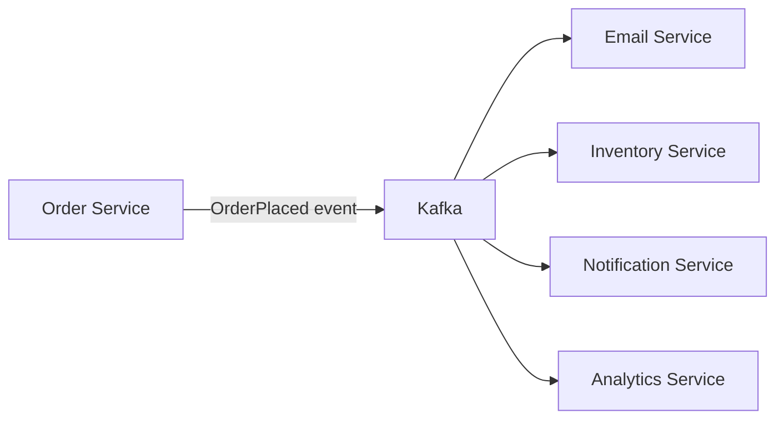
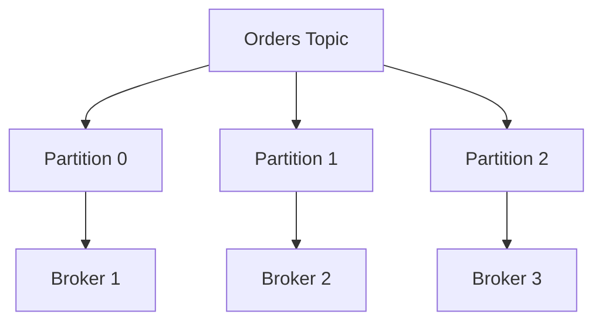
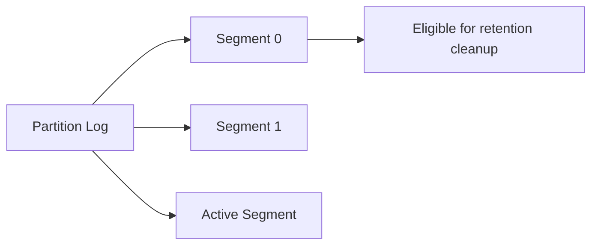
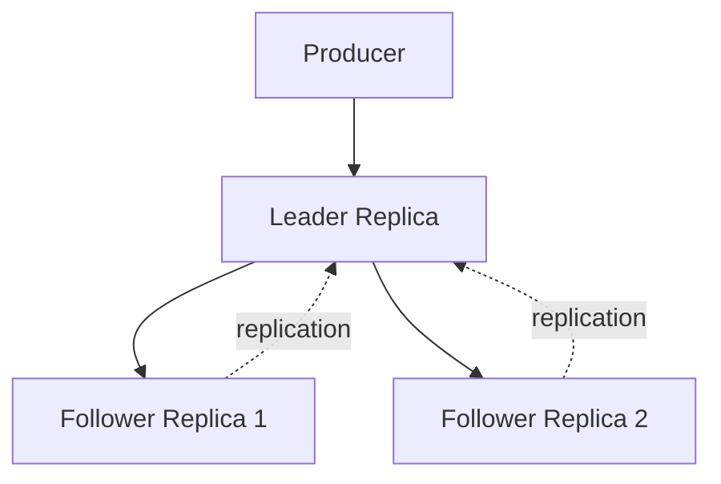
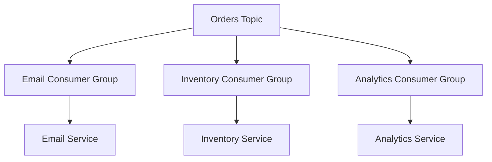
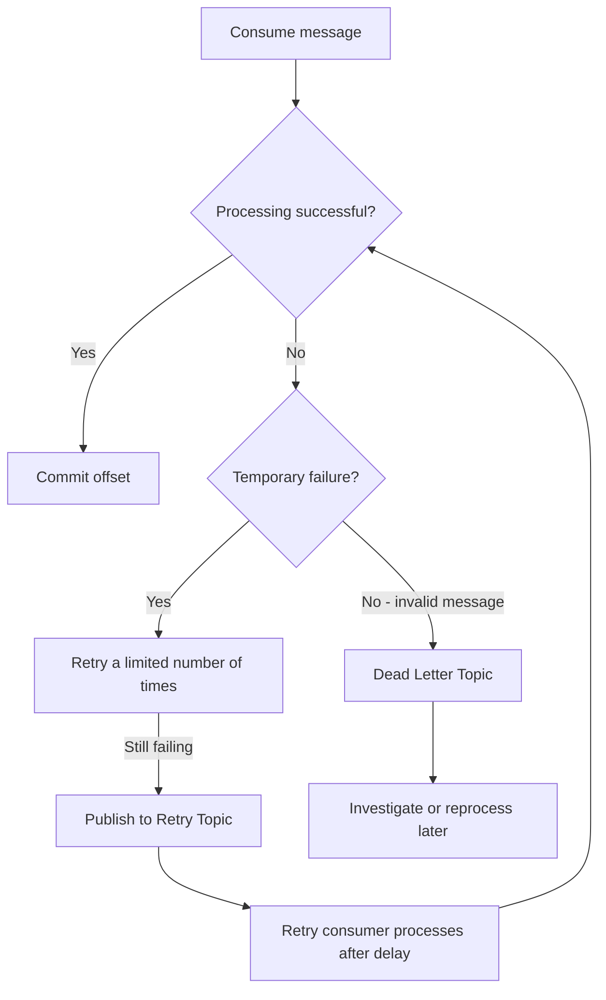
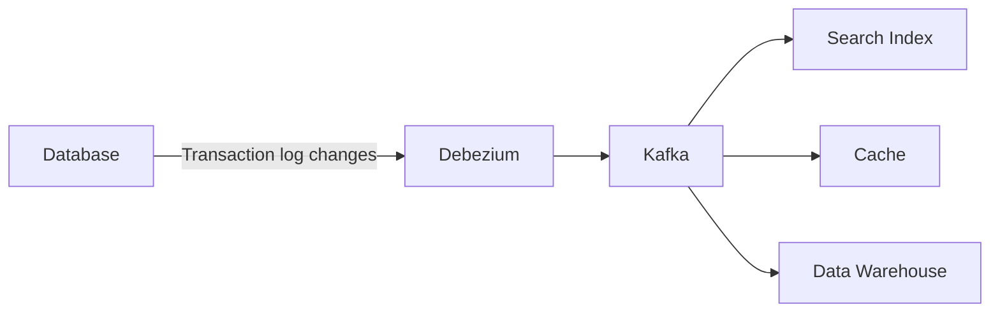

# Apache Kafka – Architecture and Working

**Distributed Systems Study Library · Author: Jayesh Sharma**

## 1. What is Apache Kafka?

Apache Kafka is a **distributed event streaming platform**. It helps applications publish, store, and process a continuous flow of events.

An **event** is a record of something that happened.

Examples:

- An order was placed.
- A payment was completed.
- A driver shared a new location.
- A customer clicked an advertisement.
- A user changed their profile.

Kafka sits between applications that produce events and applications that consume them. Producers do not need to know which services will process their events. Consumers can read events independently and at their own pace.

### Why use Kafka?

Imagine an order service. When an order is placed, several services may need to react:

- Inventory service updates stock.
- Notification service sends an email or push notification.
- Analytics service records the order.
- Activity service updates the customer's history.

Without an event broker, the order service may need to call every service directly. This creates tight coupling.

With Kafka, the order service publishes one event. Each interested service consumes it independently.

**Benefits:** loose coupling, independent scaling, buffering during traffic spikes, and the ability to replay retained events.

## 2. Kafka vs a traditional message queue

A traditional task queue commonly gives a message to a worker for processing. After successful acknowledgement, the message can be removed from the queue.

Kafka uses a different model: it stores events in an **append-only log**. Reading an event does not normally delete it. Consumers track their own reading positions (offsets), and Kafka retains records according to its retention configuration.

| Traditional task queue | Kafka |
|---|---|
| Often used to distribute tasks among workers | Often used to distribute event streams to multiple services |
| Acknowledged messages are commonly removed | Reading a record does not remove it |
| Usually focused on task processing | Supports independent consumers and replay |
| Good for background jobs | Good for high-volume event streaming |

Kafka is not simply a queue with more capacity. Its retained log and independent consumer positions are important differences.

## 3. Topics, partitions, and offsets

### Topic

A **topic** is a named stream of related events.

Examples: `orders`, `payments`, `driver-locations`.

### Partition

A topic is split into smaller units called **partitions**. Each partition is an ordered log. Partitions can be distributed across multiple Kafka brokers.

Why partitions? A single log on one server can become a bottleneck. Multiple partitions allow work to be distributed across servers and processed in parallel.

### Offset

An **offset** is the position of a record within a particular partition. It increases as records are appended.

Example:

| Partition | Offset | Event |
|---|---:|---|
| 0 | 0 | Order A created |
| 0 | 1 | Order B created |
| 0 | 2 | Order C created |
| 1 | 0 | Order D created |
| 1 | 1 | Order E created |

Offsets are unique within a partition, not across the entire topic. For example, Partition 0 and Partition 1 can both contain offset 0.

### Message ordering

Kafka guarantees ordering **within a partition**, not across all partitions in a topic.

If events must be processed in order for a particular order, send them to the same partition using the order ID as the key.

## 4. Kafka brokers and cluster coordination

A **broker** is a Kafka server that stores partitions and handles producer and consumer requests. Multiple brokers together form a Kafka cluster.

A topic's partitions are distributed across brokers.

Kafka also needs to maintain cluster metadata, such as:

- Which topics exist.
- How many partitions each topic has.
- Which brokers host the partitions.
- Which replica is the partition leader.

Older Kafka deployments used ZooKeeper for coordination. Modern Kafka uses **KRaft** (Kafka Raft) for metadata management. KRaft controllers maintain a replicated metadata log. Kafka 4.0 no longer supports ZooKeeper.

For most application designs, remember the distinction: brokers store and serve partition data; KRaft controllers manage cluster metadata and coordination.

## 5. How Kafka stores messages on disk

Each partition is stored as a log. The log is divided into smaller files called **segments**.

- New records are appended to the active segment.
- When a segment reaches a configured size or time limit, Kafka rolls over to a new segment.
- Older segments can be deleted when they become eligible under retention rules.

The transcript describes a default segment size of approximately 1 GB; actual values are configurable.

### Why is Kafka fast?

1. **Sequential writes:** Kafka appends records rather than frequently updating scattered disk locations.
2. **Batching:** multiple records can be written together, reducing request and I/O overhead.
3. **Page cache:** the operating system keeps recently accessed file data in memory, which can speed up reads.
4. **Zero-copy:** where supported, data can move from the page cache to the network with fewer copies through application memory.

Segments also make retention cleanup efficient: Kafka can remove an eligible segment as a unit instead of deleting individual records one by one.

## 6. Producers: how messages are written

A **producer** is an application that sends records to Kafka.

A record commonly contains:
- **Key:** optional; helps decide the partition.
- **Value:** the actual event data.
- Other metadata such as headers and timestamp may also be present.

### How does Kafka select a partition?

When a record has a key, the producer normally uses the key to select a partition. Records with the same key are routed to the same partition, provided the partition count and partitioning logic remain unchanged.

Records without keys can be distributed across partitions according to the producer's partitioning strategy.

Example: use `orderId` as the key.

- Order 101: Created → Paid → Shipped
- All three events are routed to the same partition.
- Kafka preserves their append order in that partition.

The producer must still send the events in the correct sequence, and the consumer must process them in the correct sequence.

### Producer batching

Instead of sending one network request for every record, the producer can group records into batches.

Two important settings:

- **batch.size:** the target batch size (in bytes).
- **linger.ms:** how long the producer can wait for more records before sending a batch that is not full.

Compression can reduce network traffic and storage usage. Larger batches and compression may add some latency or CPU work, so there is a throughput-versus-latency trade-off.

### Choosing a partition key: ordering vs load distribution

A good key should preserve the ordering the application needs without concentrating too much traffic on one partition.

**Order processing:** `orderId` is a useful key because events for one order need to stay together.

**Advertisement clicks:** using `advertiserId` may create a hot partition if one advertiser generates far more clicks than others.

Possible approaches:
- Use a more granular key, such as `adId`, if its ordering semantics are suitable.
- Add a suffix to spread traffic across keys when strict per-key ordering is not required.
- Aggregate the partial results later.

A **hot partition** is a partition receiving much more traffic than others. Adding consumers alone will not fix a single hot partition within one consumer group.

## 7. Replication, leaders, followers, and ISR

Kafka replicates partitions to protect data against broker failures.

The **replication factor** is the number of copies maintained for a partition.

For a replication factor of 3:
- One replica is the **leader**.
- Two replicas are **followers**.
- Producers write to the leader.
- Followers fetch records from the leader to keep their logs up to date.

### In-Sync Replicas (ISR)

ISR is the set of replicas that are sufficiently caught up with the leader.

If a follower falls too far behind, Kafka can remove it from the ISR. It may rejoin after catching up.

If the leader fails, Kafka can elect an eligible in-sync replica as the new leader. Producers and consumers then discover the new leader and continue.

Replication helps protect data, but the producer acknowledgement setting determines when a write is considered successful.

## 8. Producer acknowledgements: acks

The producer's `acks` setting controls how much acknowledgement it waits for.

| Setting | Meaning | Trade-off |
|---|---|---|
| `acks=0` | Producer does not wait for a broker acknowledgement | Lowest wait, but the producer may not know a write failed |
| `acks=1` | Leader acknowledges after appending the record to its local log | Faster, but the leader can fail before followers replicate it |
| `acks=all` | Leader waits for the current ISR replicas to acknowledge the write | Stronger durability, potentially more latency |

With `acks=all`, the leader waits for the replicas currently in the ISR. It does not necessarily mean every configured replica is in sync.

### min.insync.replicas

This setting specifies the minimum number of ISR replicas required for a write using `acks=all` to succeed.

A common configuration for important events is:

- Replication factor = 3
- `min.insync.replicas=2`
- Producer `acks=all`

This requires at least two in-sync replicas for such writes to succeed. With replicas on separate brokers, this configuration can tolerate one broker failure while continuing to accept writes, assuming the remaining replicas and cluster are healthy.

If fewer than two replicas are in sync, writes are rejected rather than silently accepting a write with insufficient replication.

**Important:** an acknowledgement means the record has been appended to replica logs; it does not necessarily mean every replica has flushed it to physical disk.

## 9. Consumers and consumer groups

A **consumer** is an application that reads records from Kafka. Kafka uses a pull model: consumers fetch records from brokers and control how quickly they process them.

A **consumer group** is a set of consumers that share the work of reading a topic.

Within one consumer group, a partition is assigned to only one consumer at a time.

Example: a topic has 6 partitions.

| Consumers in one group | Typical assignment |
|---:|---|
| 3 | 2 partitions per consumer |
| 6 | 1 partition per consumer |
| 7 | 1 consumer remains idle |

Therefore, the number of partitions limits the number of consumers that can actively read that topic in parallel within a single group.

### Multiple consumer groups

Different groups can independently read the same topic.

For an `OrderPlaced` event:
- Email consumer group sends email.
- Inventory consumer group updates stock.
- Analytics consumer group records metrics.

Each group maintains its own progress.

Inside each group, consumers share partitions. Across groups, each group processes the stream independently.

## 10. Consumer offsets and commits

A consumer tracks its position using offsets. A **committed offset** is the position from which the group should resume reading.

If a consumer has successfully processed offset 5000, it normally commits 5001 as the next position to read.

The timing of the commit matters.

### At-most-once processing

The consumer commits the offset before processing the record.

If it crashes after committing but before processing, the next consumer starts after that record. The record may be skipped.

**Simple meaning:** a message is processed zero or one time; loss is possible.

### At-least-once processing

The consumer processes the record first and commits the offset after successful processing.

If it crashes after processing but before committing, the record can be read and processed again.

**Simple meaning:** processing is retried until successful, but duplicates are possible.

| Strategy | Commit timing | Main risk |
|---|---|---|
| At-most-once | Before processing | Message may be lost |
| At-least-once | After processing | Message may be processed more than once |

Many applications prefer at-least-once delivery and make processing idempotent so duplicates do not cause duplicate effects.

Automatic offset commits do not necessarily mean application processing has completed. Applications that need tighter control often commit explicitly after successful processing.

## 11. Rebalancing

**Rebalancing** happens when Kafka redistributes partition assignments among consumers in a group.

It may happen when:
- A consumer joins or leaves the group.
- A consumer fails or stops sending heartbeats.
- New partitions are added.
- A consumer does not call `poll()` within the configured allowed interval.

Two approaches mentioned in the transcript:

- **Eager rebalancing:** consumers temporarily give up their assignments while the group redistributes partitions. This can interrupt the whole group.
- **Cooperative rebalancing:** only partitions that need to move are reassigned, reducing disruption.

Long processing between polls can cause unnecessary rebalances. For example, a consumer that makes a slow external API call before polling again may exceed its configured poll interval.

Ways to reduce this:
- Choose appropriate processing batch sizes and poll settings.
- Avoid long blocking work in the polling thread.
- Separate polling from long-running processing when appropriate.
- Make processing safe against retries and duplicate delivery.

## 12. Duplicate prevention: idempotent producers

Consider this situation:

1. Producer sends a batch.
2. Kafka stores it successfully.
3. The acknowledgement is lost in the network.
4. Producer assumes the write may have failed and retries.
5. The same records might otherwise be written twice.

An **idempotent producer** helps Kafka identify retry duplicates. Kafka uses a producer ID and sequence numbers to detect duplicate batches from retries.

Idempotence prevents duplicates caused by supported producer retries. It does not automatically make arbitrary application operations or external database updates idempotent.

## 13. Kafka transactions and exactly-once processing

Suppose an application:
1. Reads records from Topic A.
2. Processes them.
3. Writes results to Topic B.

Kafka transactions can atomically commit:
- The output records.
- The consumed input offsets.

Either both are committed or neither is. A downstream consumer configured to read only committed records can avoid seeing aborted transactional output.

This supports exactly-once processing for suitable Kafka-to-Kafka workflows.

### Important limitation: external systems

Kafka transactions do not automatically include an external database or payment provider.

Example:
1. Consumer receives a payment event.
2. It charges the customer's card.
3. It crashes before committing the Kafka offset.
4. On restart, the event may be processed again.

Kafka cannot undo the first charge or prevent a second charge on its own.

### Application-level idempotency

For database updates:
- Give every event a unique event ID.
- Store the processed event ID and business update in the same database transaction.
- If the event ID already exists, skip the duplicate.

For payments:
- Use the payment provider's idempotency key, if supported.
- Reuse the same key when retrying the same payment.

**Practical lesson:** at-least-once delivery combined with idempotent application processing is often simpler than trying to guarantee exactly-once execution across multiple independent systems.

## 14. Retry topics and dead-letter topics

A **poison message** is a record that repeatedly fails processing, for example because it contains invalid data or refers to a missing record.

Repeatedly retrying it in place can block later records in the same partition.

Kafka does not automatically move failed records to a dead-letter queue. The application or processing framework must implement this handling.

A common flow:

A retry topic lets the original consumer move on after safely handling the failed record. Kafka transactions can help atomically publish a failed record to another topic and commit its original offset.

**Ordering trade-off:** moving a failed record to a retry topic can allow later records with the same key to be processed first. If strict ordering is required, pause that partition until the failed record is resolved.

## 15. Log compaction

Normal time- or size-based retention keeps records for a configured period or until a configured storage limit applies.

Sometimes an application needs only the **latest value for each key**, rather than every historical change. Kafka supports this using **log compaction**.

Example: user settings.

| Key | Value |
|---|---|
| user-101 | theme=light |
| user-101 | theme=dark |
| user-101 | theme=dark, language=en |

After compaction, Kafka aims to retain the latest value for the key. Compaction runs in the background, so older versions may remain for some time.

### Tombstone

To delete a key from a compacted topic, a producer sends a record with that key and a null value. This is called a **tombstone**.

The tombstone signals deletion. Kafka retains it for a configured period, then it can be removed during cleanup.

Compacted topics are useful for rebuilding a service's latest state, such as loading current user settings into a local cache, without replaying every historical update.

## 16. Consumer lag and traffic spikes

Kafka can buffer events when producers temporarily send records faster than consumers can process them, provided the cluster has sufficient storage and capacity.

**Consumer lag** measures how far a consumer group is behind the latest records in a partition. It is commonly understood as the difference between the latest log position and the group's committed position.

Example:
- Latest position: 10,000
- Consumer committed position: 9,200
- Approximate lag: 800 records

During a flash sale, incoming events may increase sharply and lag can grow.

To reduce lag:
- Optimize consumer processing.
- Add consumers, if there are enough partitions.
- Distribute keys more evenly to avoid hot partitions.
- Check downstream dependencies and database throughput.
- Review retention settings so records are not removed before consumers can catch up.

Adding consumers beyond the number of available partitions does not increase parallel consumption for that group.

## 17. Common Kafka use cases

### A. Event-driven fan-out

An order service publishes `OrderPlaced`. Inventory, notifications, and analytics consume it using separate consumer groups.

### B. Change Data Capture (CDC)

CDC tools such as Debezium read database changes from a transaction log and publish them to Kafka.

This helps keep downstream systems synchronized with database changes.

### C. Event sourcing

Instead of storing only the current state, an application stores the sequence of events that produced that state.

Example:
`OrderPlaced` → `PaymentCompleted` → `OrderShipped`

Replaying the events in order can reconstruct the order's state. Kafka can be part of such an architecture, though event sourcing also requires careful decisions about durable event storage, schemas, and replay.

### D. Log aggregation

Applications and servers publish logs to Kafka. Consumers forward them to search systems such as Elasticsearch or to object storage for analysis.

### E. Stream processing

Tools such as Kafka Streams and Apache Flink continuously consume events, transform or aggregate them, and publish results to Kafka or another data store.

## 18. Kafka vs RabbitMQ vs Amazon SQS: choosing the right tool

The transcript's main distinction is the workload and delivery model, not that one technology is always better.

| Requirement | Kafka | RabbitMQ / Amazon SQS |
|---|---|---|
| High-volume event streams | Strong fit | Can work, depending on requirements |
| Multiple services independently consume the same events | Strong fit through consumer groups | Possible, but patterns differ |
| Replay retained events | Built-in log-based model | Depends on queue/service capabilities and configuration |
| Distribute independent background tasks | Possible | Common, natural fit |
| Simple job processing with retries | May be more infrastructure than needed | Often simpler |
| Preserve order within a stream | Per-partition ordering | Depends on queue type and configuration |

Example: video transcoding. Each uploaded video creates a job that a worker can pick up and process. A task queue such as SQS or RabbitMQ is often a straightforward choice.

Kafka and a traditional task queue can also coexist in the same architecture.

### When Kafka may be unnecessary

- **Low traffic:** a simpler queue or database-backed job queue may be sufficient.
- **Immediate request-response:** use a direct API call for something like checking username availability.
- **Large files:** store the file in object storage such as Amazon S3 and publish its reference through Kafka.
- **Too many topics or partitions:** do not create one topic or partition per user. Use a reasonable number of partitions and a user ID as the key when per-user ordering is needed.

Kafka is designed for event streams, not for transferring large files.

## 19. Important design trade-offs to remember

| Design choice | Benefit | Trade-off / risk |
|---|---|---|
| More partitions | More parallelism and distribution | More metadata and operational overhead |
| Larger producer batches | Better throughput | Potentially higher latency |
| Stronger acknowledgements | Better protection against broker failure | More write latency and reduced availability in some failures |
| At-least-once processing | Avoids skipping work in common failure cases | Duplicates must be handled |
| More consumers | More processing capacity when partitions are available | No benefit beyond available partition parallelism |
| Retry topics | Allows processing to continue | Can affect ordering |
| Log compaction | Retains latest state per key | Cleanup is asynchronous |

## 20. Quick revision – interview points

1. Kafka is a distributed event streaming platform.
2. A topic is a named stream; a partition is an ordered log within that topic.
3. An offset identifies a record's position within a partition.
4. Ordering is guaranteed within a partition, not across a topic's partitions.
5. A broker stores and serves partition data.
6. KRaft manages Kafka cluster metadata; modern Kafka does not require ZooKeeper.
7. A partition key influences both ordering and load distribution.
8. A consumer group shares partition work; one partition is assigned to one consumer in that group at a time.
9. Different consumer groups can independently read the same topic.
10. Replication factor controls the number of partition copies; ISR tracks sufficiently caught-up replicas.
11. `acks` and `min.insync.replicas` influence write durability.
12. Committing an offset after processing supports at-least-once behavior, but duplicates are possible.
13. Idempotent producers protect against duplicate writes caused by supported retries.
14. Kafka transactions support atomic Kafka input-offset and output-record commits.
15. External side effects still need application-level idempotency.
16. Poison messages need retry and dead-letter handling in the application.
17. Log compaction retains the latest value per key over time.
18. Consumer lag indicates how far behind a consumer group is.
19. Kafka is well suited to event streams and replay; task queues are often simpler for independent background jobs.

---

## Simple mental model

Think of Kafka as a **distributed, durable event notebook**:

- Producers write events into topics.
- Topics are split into partitions.
- Brokers store those partitions.
- Offsets mark positions in each partition.
- Consumers read at their own pace.
- Consumer groups share the work.
- Replicas protect against broker failures.
- Retention and compaction control what data remains available.

**The key idea:** Kafka separates the production of events from their consumption, while retaining the event stream so multiple services can process it independently.
