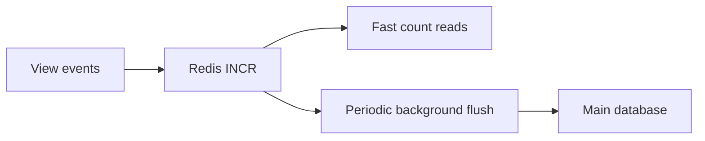
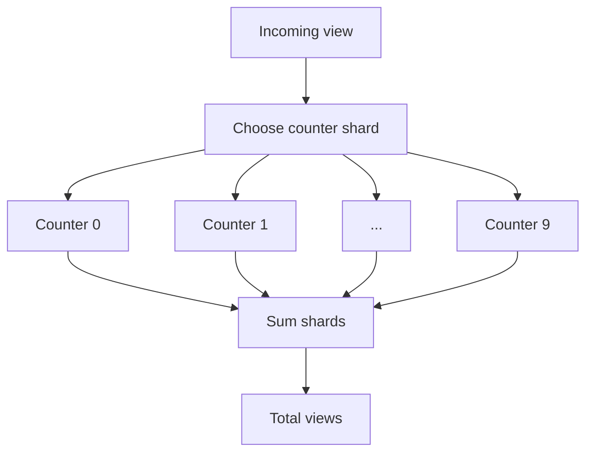
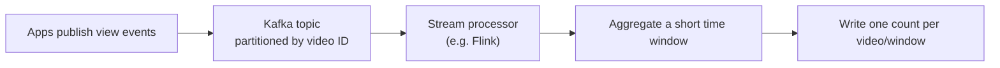
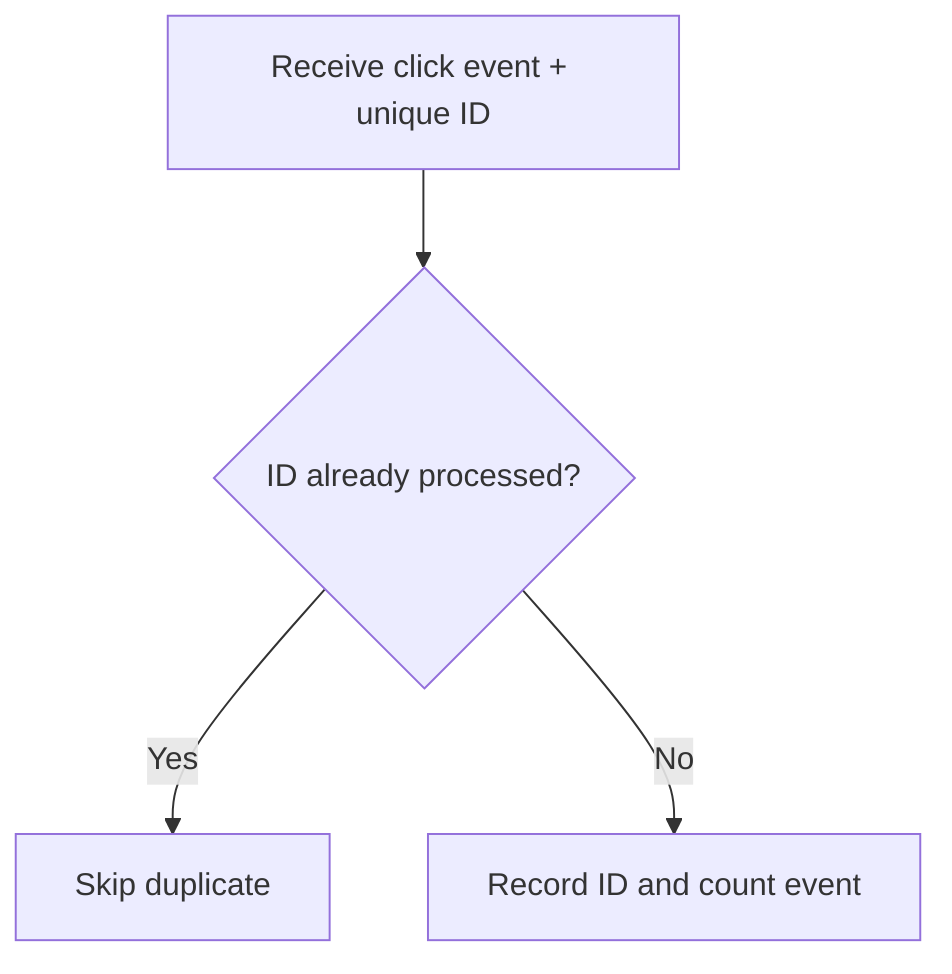
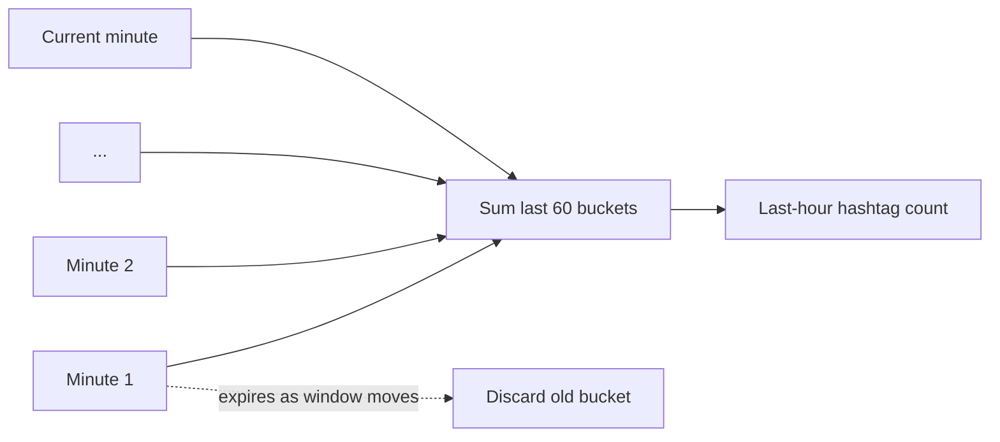
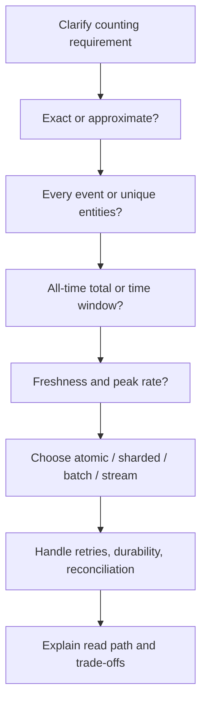

# Distributed Counters and Counting at Scale — Simplified Notes

*Database & Distributed Systems Study Notes · Author: Jayesh Sharma*

> **Source:** Simplified from the supplied video transcript (approximately 11 minutes). Examples and diagrams are explanatory additions.

## 1. What does counting at scale mean?

Apps count video views and likes, ad clicks, unique visitors, requests per user in a rate limiter, and hashtag uses in trending features. They look similar, but first ask:

- Must the answer be exact, or is an estimate okay?
- Are we counting every event or unique people/items?
- Is this an all-time total or a recent time window?
- How quickly must the count update?

These answers determine the design.

## 2. Why a simple database counter can fail

For a small app, a row containing a video ID and view count may be enough. But consider two servers incrementing a counter currently at 100:

```mermaid
sequenceDiagram
  participant A as Server A
  participant DB as Database
  participant B as Server B
  A->>DB: Read views = 100
  B->>DB: Read views = 100
  A->>DB: Write 101
  B->>DB: Write 101
  Note over DB: Final 101; expected 102
```

Both servers read the same old value. One increment disappears. This is a **race condition**.

Use an **atomic increment**—the database increments the value as one indivisible operation—so updates are not lost. But atomic correctness does not mean unlimited throughput: a very popular counter can become a hot row.

## 3. Redis atomic counters

Redis offers the atomic INCR command. It is fast because it works in memory and safely processes commands.

```text
INCR video:42:views
```

A common design increments Redis and periodically copies the count to the main database:



**Trade-off:** Redis persistence settings matter. If recent increments are not durably saved, a crash may lose them. A few lost views may be acceptable; lost billable ad clicks usually are not.

## 4. Sharded counters: split one hot key into many

A single Redis key can still be overloaded. Instead, create multiple counters, such as ten keys numbered 0–9. Each new view increments a randomly selected counter. To display the total, sum all shards.



- **Benefit:** writes spread across keys/nodes.
- **Cost:** reads combine shard values.
- **Optimization:** cache the combined result briefly; view counts need not refresh for every view.

## 5. Batch counting and stream processing

Instead of one database update per view, servers collect counts briefly and send batches. For example, if one server receives 300 views in a second, it can send “add 300” once rather than 300 updates.



Using video ID as Kafka partition key groups events for the same video. A processor aggregates events over a short window (e.g. 10 seconds) and writes an aggregate.

**Trade-off:** displayed counts may lag by a few seconds, often acceptable for views and likes.

## 6. Exact counting: ad clicks and money

Billing counts must be accurate. Retries and consumer restarts may deliver the same event more than once.

Give every click a unique event ID. Track which IDs were already counted; ignore duplicates.



Stream processors can support exactly-once processing when configured correctly, but end-to-end design must consider event delivery, state, and output writes.

A robust billing design keeps:
- A real-time count for dashboards.
- Raw click events stored durably.
- A periodic batch recount used as billing source of truth.
- Reconciliation comparing real-time results with the recount.

Real-time is fast; the batch recount checks accuracy.

## 7. Count unique users: HyperLogLog

Counting events differs from counting unique people. If one person watches five times, views increase by five, but unique viewers increase by one.

An exact unique count stores every user ID in a set, which can consume huge memory. **HyperLogLog (HLL)** estimates unique items using a small, fixed amount of memory. Redis's standard HLL representation uses roughly 12 KB; its estimate is approximate, typically with error under 1%.

For 50 million unique users, an error of around 0.8% could mean about 400,000 users either way. That may be okay for analytics, not billing. HLL structures can be merged across servers or periods.

| Use case | Choice |
|---|---|
| Analytics: unique visitor estimate | HLL may be suitable |
| Billing / entitlement count | Exact records and carefully designed processing |
| Small unique-user list | Exact set |

## 8. Counts over a time window

A rate limiter may ask: “How many requests did this user make in the last 60 seconds?”

### Fixed window
Keep a counter for each user and time bucket, then expire old keys. It is simple, but has an edge problem: a user may send the full limit at 10:05:59 and the full limit again at 10:06:00.

### Sliding window
Combine the current and previous buckets, weighting the previous bucket by how much of it still falls inside the last 60 seconds. For trending hashtags, keep one count per hashtag per minute and sum the latest 60 buckets.



## 9. Find top hashtags: Count-Min Sketch

Counting millions of hashtags is one task; finding the top ten is another.

A **Count-Min Sketch** is a compact table that estimates item frequency:
- Uses limited, fixed-size memory.
- Estimates may be a little too high.
- It is designed not to underestimate.
- It can be paired with a small candidate list of top items.

Another approach partitions events by hashtag. Workers find local top tens, then a final step merges those lists. Partitioning by hashtag helps ensure each hashtag's count is collected consistently.

## 10. System design interview checklist



Estimate peak write rate, especially for the most popular counter. Registered-user count alone is not enough.

## 11. Quick revision table

| Need | Technique | Trade-off |
|---|---|---|
| Correct single counter | Atomic increment | Hot row/key bottleneck |
| Fast in-memory counter | Redis INCR | Durability depends on configuration |
| Very hot counter | Sharded counters | Reads sum shards |
| Reduce update volume | Batch aggregation | Count is delayed |
| High-volume pipeline | Kafka + stream processor | Complexity and lag |
| Exact billable events | Unique IDs + durable raw events + reconciliation | Storage and processing cost |
| Approximate unique users | HyperLogLog | Estimate, not exact |
| Recent time window | Fixed/sliding windows | Fixed-window boundary burst |
| Top items | Count-Min Sketch + candidates / partitioned top-K | Approximation or merge complexity |

## Key takeaway

There is no single counter design for every use case. First decide whether you need an exact count, unique count, or recent-window count—and how fresh it must be.

- Atomic operations prevent lost updates.
- Sharding and batching reduce hot-key pressure.
- Unique IDs help prevent duplicate billable events.
- HyperLogLog estimates unique users efficiently.
- Count-Min Sketch estimates item frequencies.
- Durable raw events and reconciliation support trustworthy financial counts.

*These notes simplify the supplied transcript. Redis durability, stream-processing guarantees, and data retention depend on the system's actual configuration.*
