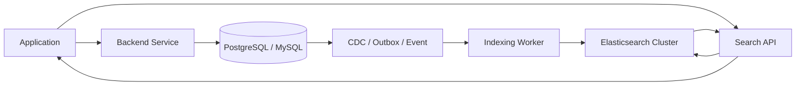
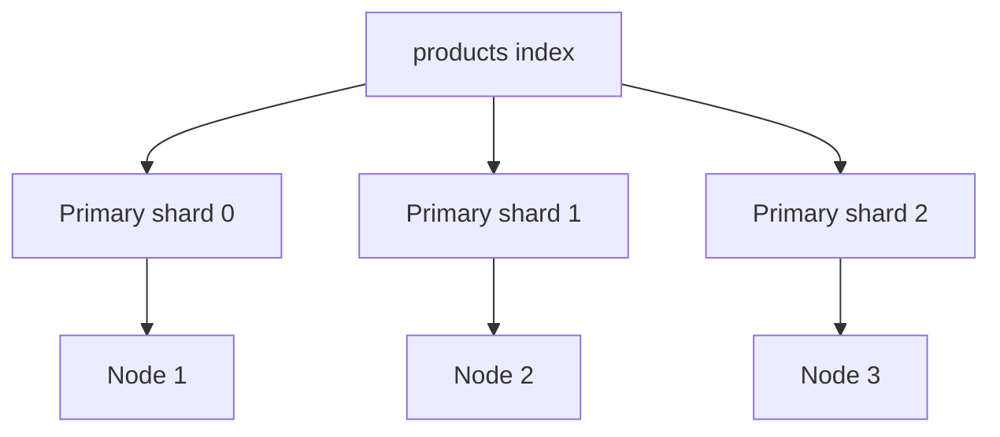
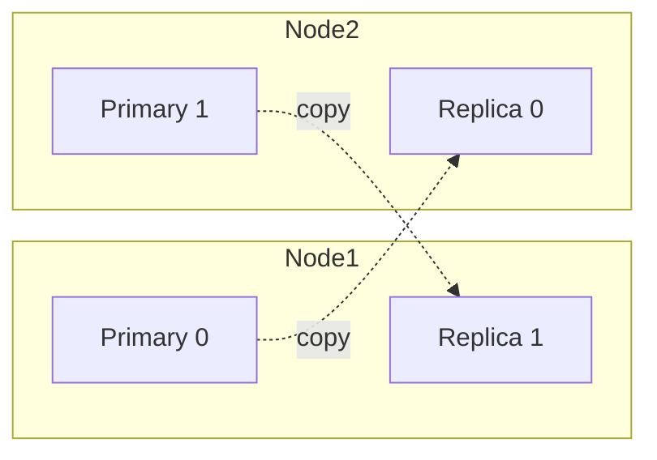
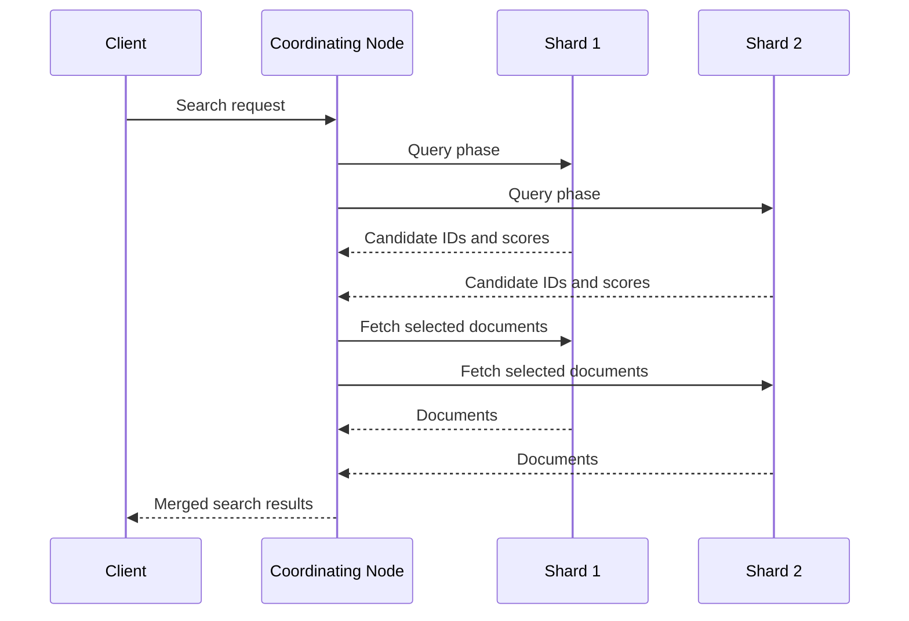
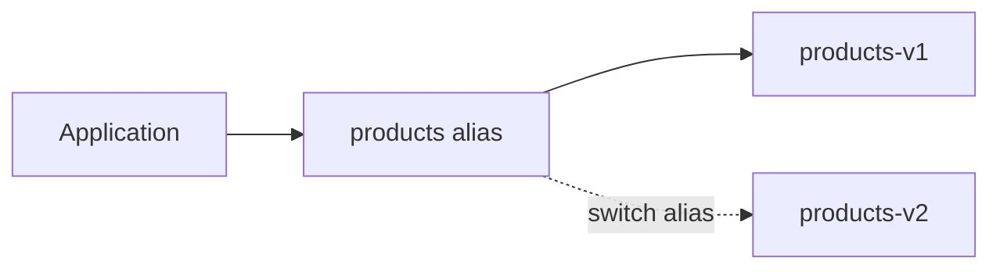

# Elasticsearch for System Design Interviews

**Distributed Systems Study Library · Author: Jayesh Sharma**

> Simple explanations · Practical examples · Architecture diagrams · Interview preparation

## 1. What is Elasticsearch?

Elasticsearch is a distributed search and analytics engine. It is designed to find information quickly across large amounts of data.

Think of an e-commerce website:

- A customer searches for **"wireless noise cancelling headphones"**.
- The system should find relevant products even if the exact phrase is not stored.
- The customer may filter by brand, price, rating, and availability.
- Results should be ranked by relevance.

A traditional database is excellent at storing and updating business records. Elasticsearch is especially good at searching and analysing those records.

**Important design principle:** Elasticsearch is usually a *search index*, not the primary source of truth. Keep authoritative business data in an OLTP database (such as PostgreSQL or MySQL), then copy the searchable fields into Elasticsearch.

### When should we use it?

- Full-text search across product catalogues, articles, and documents.
- Search suggestions and autocomplete.
- Filtering and faceted navigation (brand, category, price range).
- Log and event exploration.
- Aggregations such as counts, averages, and trends.

Do not choose Elasticsearch simply because an application needs to store data. For transactions, constraints, and authoritative updates, a relational database is usually a better fit.

## 2. High-level architecture

A common architecture separates the write path from the search path.



**How it works:**

1. The application creates or updates a product in the primary database.
2. A reliable change-capture mechanism (CDC, transactional outbox, or event) publishes the change.
3. An indexing worker transforms the record into a search document.
4. The worker indexes that document in Elasticsearch.
5. Search requests go to Elasticsearch, not to the transactional database.

This is an **eventually consistent** design: a newly updated product may take a short time to appear in search.

For important workflows, define what the application should do during that delay. For example, product details and checkout should still read authoritative data from the primary database.

## 3. Core terminology

| Term | Simple meaning |
|---|---|
| Cluster | A group of Elasticsearch nodes working together |
| Node | One running Elasticsearch instance |
| Index | A logical collection of related documents |
| Document | One JSON record, such as one product |
| Field | A property inside a document |
| Mapping | Defines field names and their data types |
| Shard | A piece of an index; internally a Lucene index |
| Primary shard | The main shard that owns a document |
| Replica shard | A copy of a primary shard |
| Analyzer | Processes text into searchable terms |
| Query | Describes what documents to find |

**Remember:** Cluster → Nodes → Indices → Shards → Documents → Fields.

Example document:

```json
{
  "productId": "P101",
  "name": "Sony Wireless Headphones",
  "description": "Wireless noise cancelling headphones",
  "brand": "Sony",
  "price": 7999,
  "category": "Electronics",
  "inStock": true
}
```

An index might be named `products`, and this JSON object is one document in it.

## 4. How does Elasticsearch search so quickly?

The key idea is the **inverted index**.

A normal book index maps a topic to page numbers. An inverted index maps a word to the documents containing that word.

Suppose we have these documents:

- D1: "red wireless headphones"
- D2: "blue wireless speaker"
- D3: "red running shoes"

A simplified inverted index could look like this:

| Term | Documents containing the term |
|---|---|
| red | D1, D3 |
| wireless | D1, D2 |
| headphones | D1 |
| blue | D2 |
| speaker | D2 |
| running | D3 |
| shoes | D3 |

When a user searches for **wireless headphones**, Elasticsearch can look up the terms and identify matching documents without scanning every document's full text.

This is the central difference:

- **Full table scan:** inspect many rows to find matching text.
- **Inverted index:** use a term-to-document lookup structure to narrow the candidates.

The real implementation is more sophisticated: it uses Lucene data structures, postings lists, term statistics, scoring, and immutable index segments.

## 5. Text analysis: why "running" and "run" can match

Before text is indexed, an analyzer processes it.

A typical analyzer has three stages:

1. **Character filters** – optionally modify the input text.
2. **Tokenizer** – splits text into tokens.
3. **Token filters** – lowercase, remove stop words, stem, or otherwise transform tokens.

Example:

```
Input: "The QUICK Running Shoes"

Lowercase: "the quick running shoes"
Tokenize:  ["the", "quick", "running", "shoes"]
Remove stop word "the"
Stem (depending on analyzer): ["quick", "run", "shoe"]
```

The exact output depends on the configured analyzer. Stemming is not automatically applied to every field.

**Why it matters:** Index-time and search-time analysis should be compatible. If they produce very different tokens, users may not find what they expect.

## 6. Mapping: define how fields are indexed

A mapping is similar to a schema. It tells Elasticsearch how to interpret each field.

Common field types:

| Type | Use |
|---|---|
| `text` | Full-text search; analysed into terms |
| `keyword` | Exact matching, sorting, and aggregations |
| `integer`, `long`, `float`, `double` | Numeric values |
| `boolean` | true / false |
| `date` | Date and time |
| `geo_point` | Latitude and longitude |

Example mapping:

```json
PUT products
{
  "mappings": {
    "properties": {
      "name":        { "type": "text" },
      "brand":       { "type": "keyword" },
      "category":    { "type": "keyword" },
      "price":       { "type": "float" },
      "inStock":     { "type": "boolean" },
      "createdAt":   { "type": "date" }
    }
  }
}
```

### text vs keyword — a common interview question

Suppose the brand is **"Sony Electronics"**.

- `text`: analysed into tokens such as "sony" and "electronics"; useful for full-text search.
- `keyword`: treated as one exact value; useful for filtering, grouping, and sorting.

A multi-field mapping lets one value support both use cases:

```json
"brand": {
  "type": "text",
  "fields": {
    "raw": { "type": "keyword" }
  }
}
```

Then use `brand` for text search and `brand.raw` for exact matching or aggregation.

**Production tip:** Explicit mappings are safer for important fields. Dynamic mapping is convenient, but unexpected values can create unwanted field types or mapping growth. Changing an existing field's type generally requires creating a new index and reindexing.

## 7. Indexing a document

An index request adds or replaces a document by ID.

```http
PUT /products/_doc/P101
{
  "name": "Sony Wireless Headphones",
  "brand": "Sony",
  "price": 7999,
  "inStock": true
}
```

- `products` is the index.
- `_doc` is the document endpoint.
- `P101` is the document ID.

Use a stable ID when you need to update the same logical record. An indexing request with an existing ID replaces the document source; the Update API can be used for partial updates.

### Bulk indexing

When importing thousands of records, avoid sending one network request per document. Use the Bulk API to send multiple index, create, update, or delete actions together.

Bulk requests reduce network overhead and improve throughput. Choose a sensible batch size, monitor response errors, and retry only failed items where appropriate. A successful HTTP response does not mean every item in the bulk request succeeded.

## 8. Near-real-time search: refresh

A document can be successfully indexed but not immediately visible to search.

Why?

Elasticsearch is **near-real-time**, not strictly immediate-search. A refresh makes recent indexing operations available to search.

Simplified flow:

```
Index request
    |
    v
Document is indexed
    |
    v
Refresh makes changes searchable
    |
    v
Search can return the document
```

The default refresh interval for an active index is commonly around one second, but it is configurable and can differ by deployment. A refresh is not the same as a database commit or a disk flush.

Useful refresh options on supported write APIs:

- `refresh=false` (default behaviour): do not force a refresh.
- `refresh=wait_for`: wait until a normal refresh makes the changes searchable.
- `refresh=true`: force an immediate refresh; use sparingly because frequent refreshes can hurt indexing and search performance.

**Interview point:** A successful write does not necessarily mean an immediate search will find the document.

## 9. Sharding: how Elasticsearch scales

An index is divided into shards. Each shard is a self-contained Lucene index and stores only a portion of the index's documents.

Suppose the `products` index has three primary shards:



Elasticsearch uses the document ID (or configured routing value) to determine which primary shard receives a document. Applications normally target the index; Elasticsearch handles shard routing.

### Why shards?

- **Horizontal scaling:** distribute data across nodes.
- **Parallel work:** multiple shards can search at the same time.
- **Capacity:** an index can be spread across multiple machines.

### Primary and replica shards

A primary shard owns the original shard data. A replica shard is a copy of a primary shard.



The diagram is conceptual: Elasticsearch allocates copies across nodes so a primary and its replica are not placed on the same node.

**Primary shards help divide data. Replicas provide redundancy and can serve search requests.** Replicas also consume storage and add replication work.

### How many shards should we create?

There is no universal correct number.

Too few shards can limit parallelism and make shards too large. Too many small shards add cluster overhead, memory use, and coordination cost.

Plan shard count using:
- Expected data volume and growth.
- Query and indexing throughput.
- Number and size of data nodes.
- Retention period and rollover strategy.
- Recovery time and operational limits.

Important: the number of primary shards is fixed when an index is created. Replica count can be changed later. To change primary-shard layout, common approaches include reindexing into a new index or using supported split/shrink operations with their prerequisites.

## 10. What happens when a search query arrives?

A coordinating node receives the request and distributes the search to the relevant shard copies.

The simplified search process is called **query then fetch**:

1. **Query phase:** each participating shard searches its local data and returns candidate document IDs and scores.
2. **Coordination:** the coordinating node merges the candidates and determines which documents belong in the requested result page.
3. **Fetch phase:** the required documents are fetched from the relevant shards.
4. **Response:** the coordinating node combines and returns the results.



Elasticsearch can choose eligible shard copies for search, including replicas, based on routing and allocation decisions.

## 11. Query types you should know

### Match query — full-text search

Use a `match` query for analysed text.

```json
GET products/_search
{
  "query": {
    "match": {
      "name": "wireless headphones"
    }
  }
}
```

The query text is analysed, and matching is based on the resulting terms and query semantics.

### Term query — exact value

Use a `term` query for exact values, commonly on `keyword`, numeric, boolean, or other non-analysed fields.

```json
GET products/_search
{
  "query": {
    "term": {
      "brand": "Sony"
    }
  }
}
```

Avoid using `term` on an analysed `text` field unless you intentionally know the indexed token representation.

### Bool query — combine conditions

A bool query combines clauses:

- `must`: must match; contributes to score.
- `filter`: must match; does not contribute to score; useful for structured constraints.
- `should`: optional or required depending on the other clauses and `minimum_should_match`.
- `must_not`: must not match.

Example: search for wireless headphones from Sony, under 10,000, and in stock.

```json
GET products/_search
{
  "query": {
    "bool": {
      "must": [
        { "match": { "name": "wireless headphones" } }
      ],
      "filter": [
        { "term": { "brand": "Sony" } },
        { "range": { "price": { "lte": 10000 } } },
        { "term": { "inStock": true } }
      ]
    }
  }
}
```

### Range query

```json
{
  "query": {
    "range": {
      "price": {
        "gte": 3000,
        "lte": 10000
      }
    }
  }
}
```

### Sorting

```json
{
  "sort": [
    { "price": "asc" }
  ]
}
```

Sorting and aggregations generally work best on fields mapped as `keyword` or numeric types, not analysed text fields.

## 12. Relevance scoring

Elasticsearch does more than return matching documents. It normally calculates a relevance score to rank results.

The default similarity commonly used for text search is BM25. At a high level, relevance depends on:
- How well the query terms match the document.
- How often a term appears in the document (with diminishing benefit).
- How rare the term is across the index.
- Document length.

Example: for a search "wireless headphones", a document whose title contains both terms is likely to rank above one that mentions only one term deep in a long description.

You can influence ranking using:
- Field boosts (title more important than description).
- `must` and `should` clauses.
- Filters to remove irrelevant results.
- Function score or other scoring features where justified.

Do not promise that a particular document will always rank first; ranking depends on mappings, analyzers, query structure, similarity, and indexed data.

## 13. Aggregations: analytics on search data

Aggregations summarise matching documents. They are useful for faceted search and dashboards.

Example: count products by brand.

```json
GET products/_search
{
  "size": 0,
  "aggs": {
    "products_by_brand": {
      "terms": {
        "field": "brand"
      }
    }
  }
}
```

Other common aggregations:
- `terms`: group by a field, such as brand or category.
- `avg`, `min`, `max`, `sum`: numeric metrics.
- `date_histogram`: group events by day, hour, or month.
- `range`: group numeric values into ranges.

For example, a product page can show "Sony (120), Bose (80), JBL (65)" as filter counts.

## 14. Pagination: from from/size to search_after

For small result pages, `from` and `size` are simple:

```json
GET products/_search
{
  "from": 0,
  "size": 10,
  "query": { "match": { "name": "headphones" } }
}
```

But deep pagination becomes expensive. To return page 100, shards may need to collect and sort many earlier results too.

For deep pagination, use `search_after` with a stable sort. For consistent traversal while documents are changing, use a Point in Time (PIT) together with `search_after`.

Conceptually:
- First request returns 10 hits and their sort values.
- The next request passes the last hit's sort values as `search_after`.
- Continue until there are no more results.

Avoid using large `from` offsets as a general deep-pagination strategy.

## 15. Scaling reads and writes

### Read scaling

- Add replica shards to provide more eligible shard copies for search.
- Add data nodes and distribute shards across them.
- Use filters and targeted queries to reduce work.
- Return only required fields and a sensible number of hits.
- Use caching where the workload benefits.
- Avoid expensive wildcard, script, and deep-pagination patterns unless needed.

### Write scaling

- Use the Bulk API instead of one request per document.
- Tune bulk size and concurrent indexing workers through measurement.
- Avoid forcing refresh after every write.
- Use suitable shard counts and avoid oversharding.
- Use a queue or event stream to absorb bursts and control indexing rate.
- Monitor rejected requests, indexing latency, disk, heap, and merge activity.

Adding nodes does not automatically make every query faster. Shard distribution, query design, data size, and resource bottlenecks all matter.

## 16. Handling updates and deletes

Elasticsearch uses immutable Lucene segments. A document update is not normally an in-place modification of bytes in an existing segment.

At a high level:
- An update creates a new version of the document.
- The old version is marked as deleted.
- Segment merges later clean up deleted-document space.

This is one reason heavy update workloads can create indexing and merge overhead.

For many workloads, Elasticsearch is best used for searchable copies of business data, while frequent transactional updates happen in the primary database.

## 17. Index aliases and zero-downtime reindexing

An alias is a logical name that points to one or more indices. Applications can query the alias instead of depending on a physical index name.

Example:

```
products-v1  <-- products (alias)
```

When a mapping change is needed:

1. Create a new index, for example `products-v2`, with the desired mapping and settings.
2. Reindex documents from `products-v1` into `products-v2`.
3. Validate document counts and search behaviour.
4. Atomically switch the `products` alias from v1 to v2.
5. Retain or remove v1 according to the rollback plan.



The alias switch is the key: the application continues using the same logical name. Reindexing copies documents; it does not automatically copy the old index's mappings, settings, or shard configuration, so configure the destination first.

## 18. Failure handling and reliability

- **Node failure:** Elasticsearch can promote an eligible replica to primary and allocate replacement copies when possible.
- **Replica unavailable:** the index may continue operating with reduced redundancy, depending on active shard availability and the operation.
- **Cluster health:** green means all primary and replica shards are allocated; yellow means all primaries are allocated but some replicas are not; red means at least one primary shard is unallocated.
- **Backpressure:** protect the cluster from bursts with queues, bounded concurrency, and retry policies with exponential backoff and jitter.
- **Retries:** distinguish transient failures from permanent mapping or validation errors. Do not retry every error blindly.
- **Snapshots:** take and test snapshots for backup and recovery. Replicas are not a substitute for backups.

## 19. Elasticsearch vs relational database vs Redis

| Requirement | Good starting choice | Why |
|---|---|---|
| Transactions and relational constraints | PostgreSQL / MySQL | Strong transactional and relational capabilities |
| Full-text relevance search | Elasticsearch | Inverted index and relevance ranking |
| Very fast in-memory key lookup | Redis | In-memory data structures and low-latency access |
| Search plus structured filters and facets | Elasticsearch | Combines text relevance with filters and aggregations |
| Authoritative order/payment records | Relational database | Transactional correctness and source-of-truth role |

These technologies can work together. They are not necessarily competing replacements.

## 20. Java example: calling Elasticsearch

A backend service can use the official Elasticsearch Java API Client. The exact client version and setup should match the Elasticsearch cluster version.

Illustrative query using the Java API Client:

```java
SearchResponse<Product> response = client.search(s -> s
        .index("products")
        .query(q -> q
            .match(m -> m
                .field("name")
                .query("wireless headphones")
            )
        ),
    Product.class
);

for (Hit<Product> hit : response.hits().hits()) {
    Product product = hit.source();
    System.out.println(product);
}
```

In a real service:
- Reuse a configured client rather than creating one per request.
- Set connection and request timeouts.
- Handle partial failures and unavailable clusters.
- Avoid logging credentials or sensitive search content.
- Keep the primary database as the source of truth.

## 21. Common mistakes and interview traps

1. **Using Elasticsearch as the primary database:** search indexes are derived and may lag behind the source of truth.
2. **Confusing text and keyword:** use `text` for analysed full-text search and `keyword` for exact values and aggregations.
3. **Assuming writes are immediately searchable:** refresh controls search visibility.
4. **Creating too many shards:** each shard adds overhead.
5. **Using deep from/size pagination:** prefer `search_after` for deep traversal.
6. **Using term query on analysed text:** use `match` for full-text search.
7. **Ignoring mapping design:** incorrect field types can make filtering, sorting, or aggregations difficult.
8. **Treating replicas as backups:** use snapshots for backup and recovery.
9. **Retrying every error:** mapping and validation errors need correction, not repeated retries.
10. **Ignoring index lag:** make eventual consistency visible in product and operational design.

## 22. Interview questions and short answers

**Q1. What is Elasticsearch?**  
A distributed search and analytics engine built on Apache Lucene. It is used for full-text search, filtering, and aggregations.

**Q2. What is an inverted index?**  
A structure mapping each term to the documents containing it, making text lookup efficient.

**Q3. What is the difference between an index and a shard?**  
An index is the logical collection. A shard is one partition of that index and is a Lucene index internally.

**Q4. Primary shard vs replica shard?**  
A primary shard owns the original partition. A replica is its copy, improving redundancy and providing another shard copy that can serve searches.

**Q5. Why is Elasticsearch near-real-time?**  
Newly indexed data becomes searchable after a refresh, not necessarily at the instant the write request completes.

**Q6. What is the difference between text and keyword?**  
Text is analysed for full-text search. Keyword is stored as an exact value for filtering, sorting, and aggregations.

**Q7. How does Elasticsearch scale?**  
It distributes shards across nodes. Searches can run across shard copies in parallel; replicas add redundancy and search capacity.

**Q8. What happens when a node fails?**  
If an eligible replica exists, Elasticsearch can promote it and later allocate replacement copies. Availability depends on shard allocation and cluster state.

**Q9. How do you handle a mapping change?**  
Create a new index with the correct mapping, reindex the documents, validate, and switch an alias.

**Q10. How do you improve indexing throughput?**  
Use bulk requests, tune concurrency and batch sizes, avoid unnecessary refreshes, and monitor cluster bottlenecks.

**Q11. Why not use Elasticsearch for every database query?**  
It is optimised for search and analytics, not as a replacement for transactional relational storage and constraints.

**Q12. How do you handle deep pagination?**  
Use `search_after`, typically with a stable sort and PIT when a consistent view is required.

## 23. Quick revision — remember these points

- **Purpose:** Search and analytics, not the usual source of truth.
- **Core data structure:** Inverted index.
- **Text processing:** Analyzer = character filters + tokenizer + token filters.
- **Schema:** Mapping defines field types.
- **Exact vs full text:** `keyword` vs `text`.
- **Scale:** Index → shards → nodes.
- **Availability:** Replicas.
- **Search visibility:** Refresh; near-real-time.
- **Query:** Match for text; term for exact values; bool to combine.
- **Analytics:** Aggregations.
- **Deep pagination:** `search_after` (and PIT for a stable view).
- **High-volume writes:** Bulk API.
- **Schema migration:** New index + reindex + alias switch.
- **Architecture:** OLTP database → change capture / event → indexing worker → Elasticsearch → Search API.

### One-line memory trick

**Database stores the truth; Elasticsearch makes that truth searchable.**

---

## References

- [AlgoMaster — Elasticsearch Deep Dive](https://algomaster.io/learn/system-design-interviews/elasticsearch) — topic framing and interview-oriented scope. The page's detailed chapter content is marked premium.
- [Elastic Docs — Index fundamentals](https://www.elastic.co/docs/manage-data/data-store/index-basics) — indices, documents, mappings, primary and replica shards.
- [Elastic Docs — Refresh API](https://www.elastic.co/docs/api/doc/elasticsearch/operation/operation-indices-refresh) — when indexed changes become searchable.
- [Elastic Docs — Reindex API](https://www.elastic.co/docs/api/doc/elasticsearch/operation/operation-reindex) — copying documents into a prepared destination index.

*These notes are independently written for learning and interview preparation; they do not reproduce the premium chapter.*
