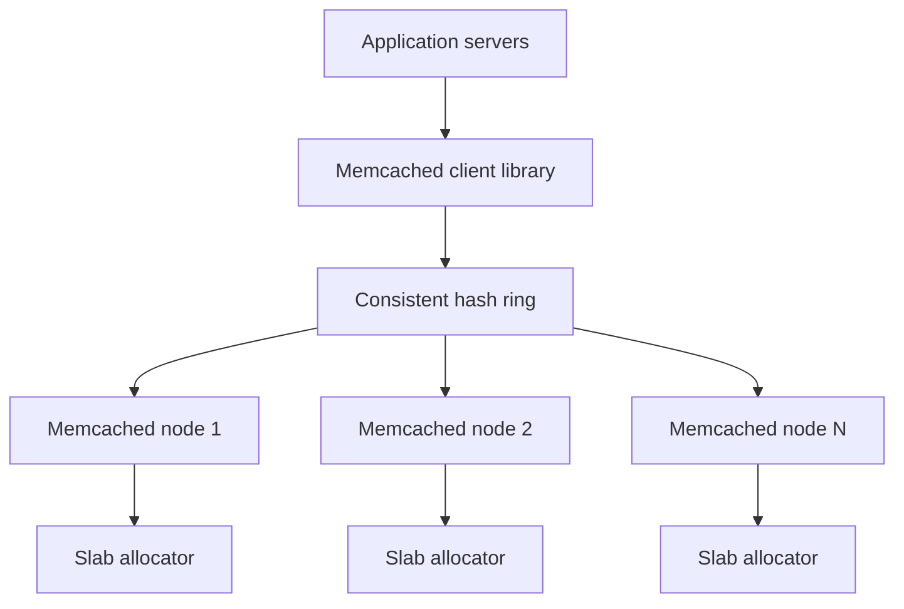
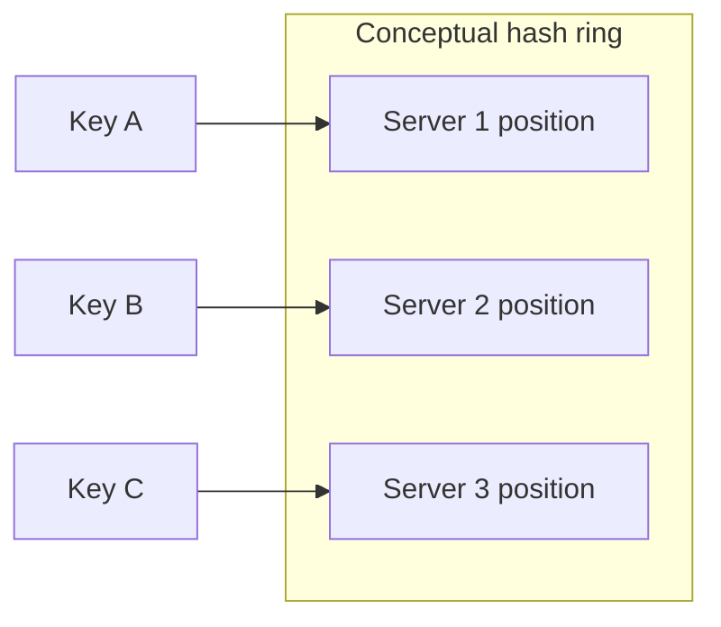
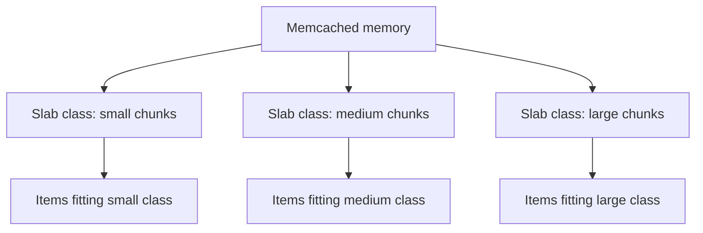
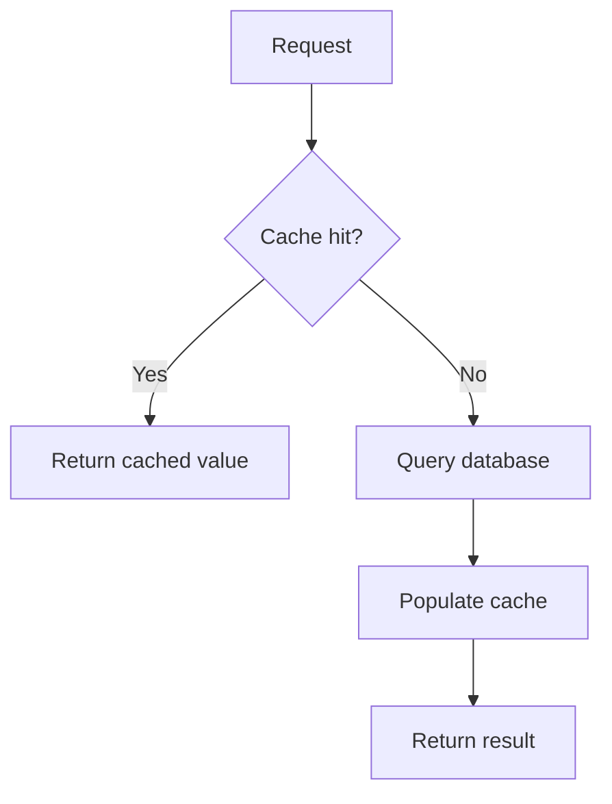
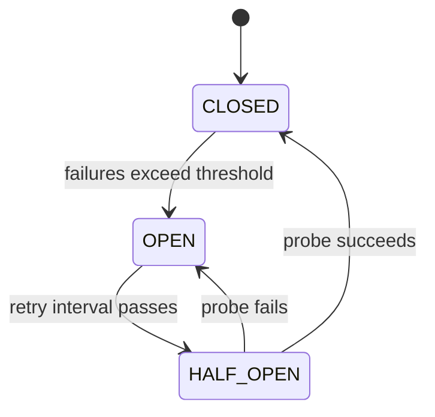

# Memcached for System Design Interviews

> Study notes based on the supplied material. Examples and interview framing are organized for quick revision.

## 1. What is Memcached?

Memcached is a distributed, in-memory key-value cache designed for high-throughput lookups. It is a good fit when cached values can be regenerated from a durable source and the application mainly needs `get`, `set`, expiration, and simple counters.

The key interview point is not simply that Memcached is fast. Explain why a plain cache is sufficient and how the application behaves when a cache node fails.

### Architecture overview

Application servers do not connect to a central cluster manager. Each client library routes a key to a node using its consistent-hash ring. Memcached nodes are independent: there is no built-in replication, coordination, or automatic failover.

**Trade-off:** a failed node means its cached keys are unavailable. The application should fall back to the source of truth and repopulate the cache.

## 2. When to choose Memcached

Choose it when:
- The workload is simple key-value caching.
- High throughput for basic reads/writes is important.
- The cache contains many small objects and memory efficiency matters.
- Cached data is disposable or rebuildable.
- Client-side horizontal scaling is acceptable.

Avoid it when you need rich data structures, persistence, built-in replication, Pub/Sub or Streams, server-side scripting, or complex atomic operations.

| Use case | Why it fits |
|---|---|
| Database query cache | Simple key-value lookup |
| API/page-fragment cache | Store serialized response values |
| Object cache | Efficiently store small serialized objects |
| Session cache | Fast lookup, provided session loss is recoverable |
| Simple counters | Atomic increment/decrement on an existing numeric key |

Interview framing: “We only need to cache serialized product objects. Memcached is sufficient because the values can be regenerated from the database and we do not need richer data structures.”

## 3. Request flow and server internals

### Request flow

1. Application requests `get("user:123")`.
2. Client hashes the key and selects a server.
3. Server looks up the key in its hash table.
4. It returns the value or a cache miss.
5. On a miss, the application can query the durable database and populate the cache.

### Server components

- **Network layer:** libevent supports efficient asynchronous I/O.
- **Worker thread pool:** multiple threads process requests concurrently.
- **Hash table:** supports fast key lookup.
- **Slab allocator:** allocates memory in size classes.

Memcached is multi-threaded, which can help simple get/set workloads use multiple CPU cores. Its client-side routing means all application instances should use a consistent server list and hashing scheme; disagreement can send the same key to different nodes and cause misses.

### Core commands

| Command | Purpose |
|---|---|
| `get` | Retrieve a value |
| `set` | Store or overwrite |
| `add` | Store only if absent |
| `replace` | Store only if present |
| `delete` | Remove a key |
| `incr` / `decr` | Atomic counter update |
| `gets` / `cas` | Check-and-set for optimistic concurrency |

Important counter detail: `incr` and `decr` require an existing numeric value. They do not create a missing key, and they preserve its current TTL. Seed a counter using `set` or `add`.

## 4. Consistent hashing

### Why modulo hashing is fragile

With `server = hash(key) % N`, changing the number of servers changes the modulo result for many keys. This can invalidate much of the cache and create a miss storm.

### Consistent hash ring

Conceptually:
1. Hash servers onto a ring.
2. Hash keys onto the same ring.
3. Store each key at the first server clockwise from its position.
4. Adding or removing a server changes ownership for only a ring segment.

**Virtual nodes** give each physical server multiple positions, improving distribution when the cluster has few servers.

| Strategy | Use |
|---|---|
| Consistent hashing | General distribution |
| Ketama | Common consistent-hashing implementation |
| Modulo hashing | Testing; fragile under membership changes |
| Key-prefix routing | Application-defined grouping or tenant routing |

## 5. Memory management: slab allocation

Memcached divides memory into slab classes containing fixed-size chunks. An item is placed in the smallest chunk class that can fit it.

This reduces external fragmentation and makes allocation efficient, but may cause **internal waste** when an item does not use its entire chunk. Memory can also become imbalanced across classes if the workload's item sizes change; slab rebalancing can help.

### Eviction and expiration
- When a slab class is full, Memcached evicts its least-recently-used item from that class.
- LRU is per slab class, not global.
- Expiration is lazy: an expired item is removed when accessed or reclaimed by the background LRU crawler. It may occupy memory beyond its TTL until then.

Memory tips: compress large values, tune chunk growth, enable slab rebalancing where appropriate, monitor slab statistics, and keep value sizes reasonably consistent.

## 6. Scaling and node failure

### Adding a node

Consistent hashing limits churn; it does not eliminate cache misses. The source database must handle the temporary increase in misses.

### Node failure options

- **Accept misses:** failed-node keys miss and are rebuilt from the source.
- **Client-side failover:** route to another node; be aware that duplicate copies and temporary inconsistency can arise.
- **Redundant storage:** write copies to multiple nodes, trading more memory and write work for availability.

A hot key can overload one node even when keys are evenly distributed. Mitigations include:
- Replicate a popular read-only value under several keys and choose one copy.
- Add a short-lived local application cache (for example, 1–5 seconds).

## 7. Cache patterns

### Cache-aside

The application explicitly reads the cache, queries the database on a miss, then stores the result. It is simple and gives the application control, but misses add latency and cached values can become stale.

### Write-through
The application writes to cache and database together. It can keep cache data fresh, but adds write latency; the cache update can fail after the database write, and rarely read values may be cached unnecessarily.

### Write-behind
The cache is updated first and the database asynchronously. This can make writes faster and batch database work, but introduces data-loss risk and complexity. It is a poor fit for Memcached because Memcached has no persistence.

### Invalidation approaches
- Time-based expiration (TTL).
- Explicit deletion after a database update.
- Versioned keys, such as `users:123:v2`.

### Cache stampede

A popular key expiring can send many requests to the database at once.

Mitigations:
1. **Locking:** use atomic `add` on a short-lived lock key so one worker refreshes the value.
2. **Probabilistic early refresh:** refresh before expiration with a probability based on remaining lifetime.
3. **Stale-while-revalidate:** return a stale-but-acceptable value while refreshing asynchronously.

## 8. Handling cache failures

| Failure | Impact | Mitigation |
|---|---|---|
| One node down | Some keys miss | Fallback, optional client failover |
| Network partition | Some nodes unreachable | Short timeouts, circuit breaker |
| Memory exhaustion | More evictions | Monitor, tune, add capacity |
| Hot key | One node overloaded | Local cache, key replication |
| Entire cache down | All requests bypass cache | Database protection and graceful degradation |

### Circuit breaker

A circuit breaker prevents repeated slow cache calls from cascading into application failure. Graceful degradation can route requests to the database, but that database must be protected with rate limits, request coalescing, and capacity planning.

Monitor hit rate, eviction rate, connection count, p99 latency, and memory usage. Thresholds depend on the workload; investigate sustained hit-rate drops or rising evictions rather than treating a single universal number as correct.

## 9. Memcached vs Redis

| Feature | Memcached | Redis |
|---|---|---|
| Data model | String/blob values | Rich data structures |
| Persistence | None | RDB and AOF |
| Replication | None built in | Primary/replica |
| Distribution | Client-side consistent hashing | Redis Cluster |
| Threads | Multi-threaded | Command execution mostly single-threaded |
| Memory overhead | Often lower for simple values | Higher per-key overhead |
| Messaging | No | Pub/Sub and Streams |
| Server-side scripting | No | Lua |
| Transactions | CAS support | MULTI/EXEC and other atomic tools |

For simple get/set traffic, performance comparisons depend on payload size, pipelining, and client implementation. The dependable distinction is feature and architecture fit, not a blanket claim that one is always faster.

- **Choose Memcached:** plain disposable key-value cache, high throughput, memory efficiency, no persistence or rich operations needed.
- **Choose Redis:** data structures, persistence, replication, messaging, or more complex atomic operations are needed.

A hybrid design can use Memcached for serialized query/object/page-fragment caches and Redis for sessions, rate limiting, leaderboards, and real-time features.

## 10. Interview checklist

When proposing Memcached, cover:
- Why the cached data is rebuildable and what the source of truth is.
- Why plain key-value operations are sufficient.
- How the client uses consistent hashing and virtual nodes.
- What happens to keys on node failure and how the database handles the miss surge.
- How slab classes, per-class LRU, and lazy expiration affect memory.
- How you mitigate hot keys, cache stampedes, and total cache outages.
- Why Redis is not required—or which Redis features would change the choice.

**Bottom line:** Memcached is deliberately narrow. It is a strong choice for simple, rebuildable, performance-sensitive caching, provided the application is designed for misses and cache failure.

---
*Prepared from the supplied material and organized into study notes. The diagrams are simplified conceptual representations.*
