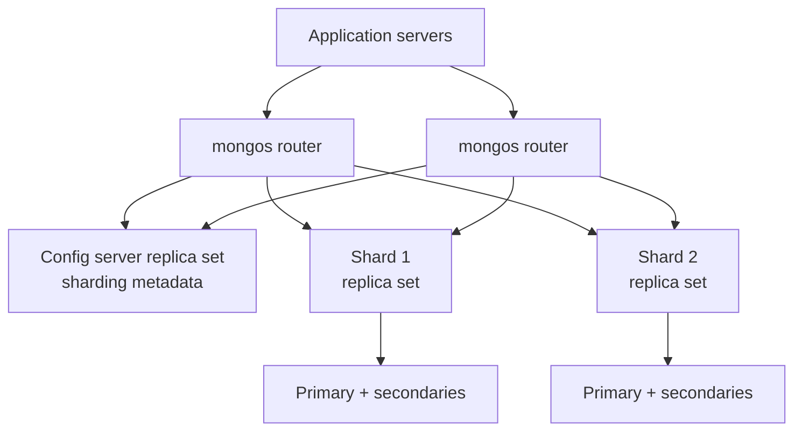
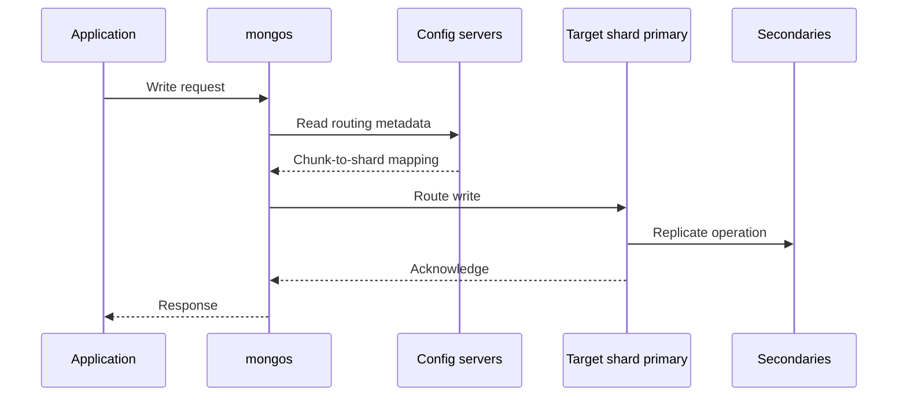
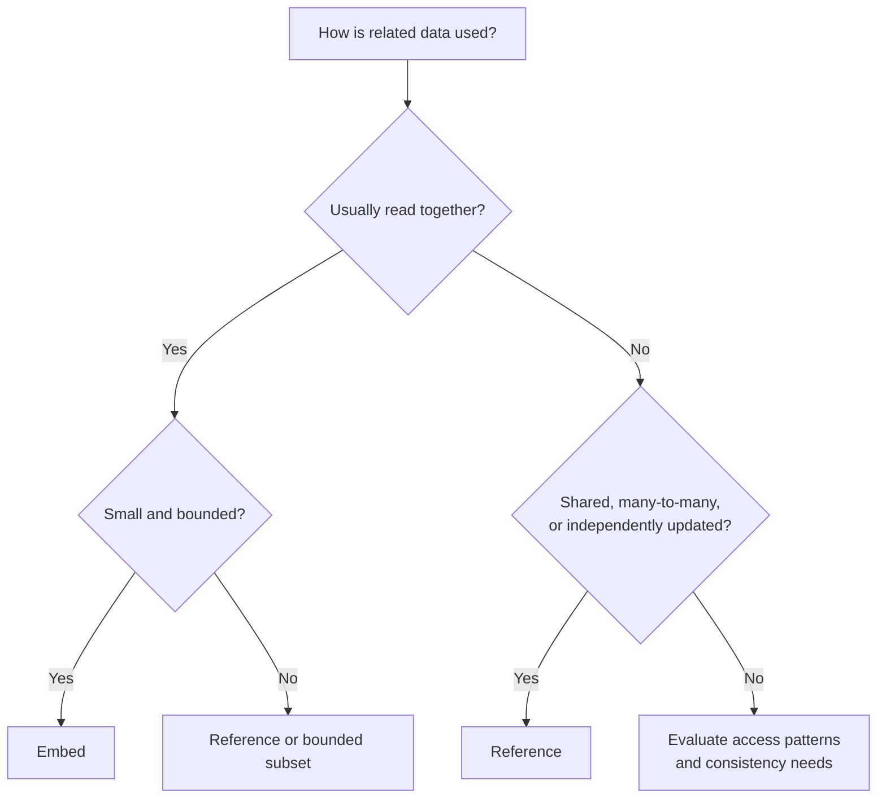
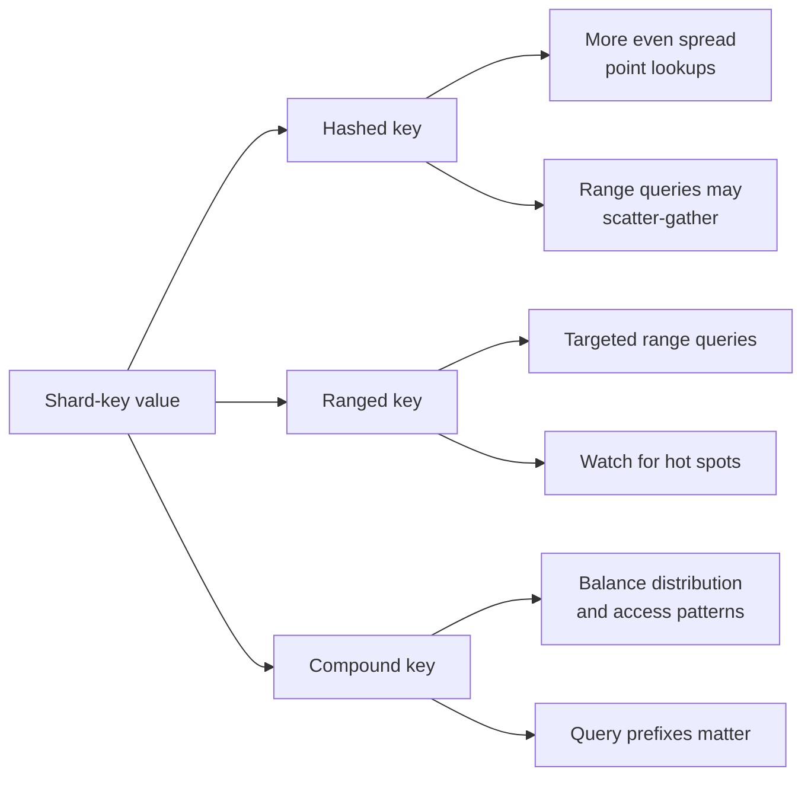
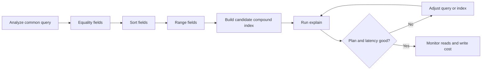
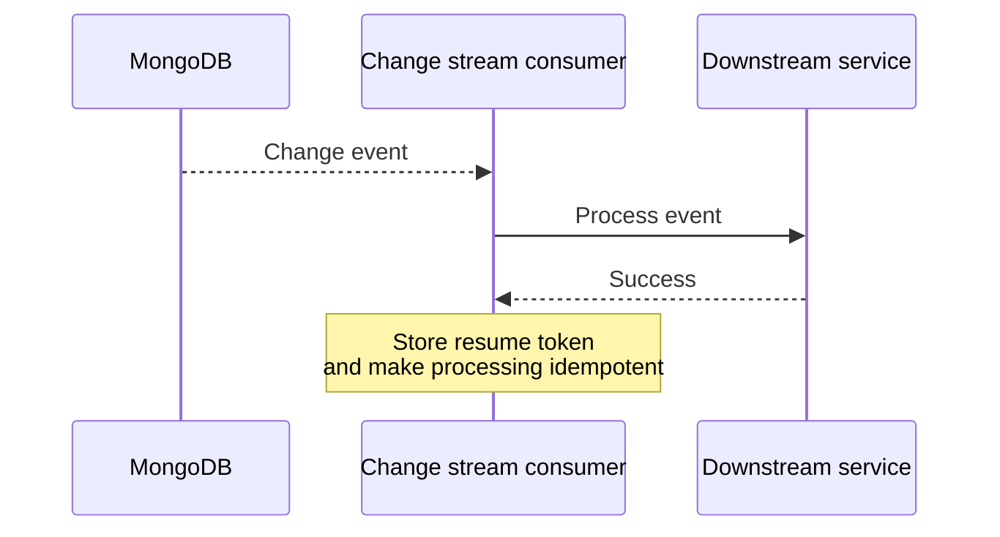

# MongoDB for System Design Interviews

> Beginner-friendly study notes based on the supplied transcript. The examples and explanations are intended to make the transcript's concepts easier to revise.

## 1. What is MongoDB?

MongoDB is a document-oriented NoSQL database. It stores records as BSON documents, which resemble JSON objects.

It is a useful fit when an application typically reads or updates a complete object—such as a user profile, shopping cart, product, or content record—and its fields may evolve over time.

MongoDB offers:
- More query capabilities than a basic key-value store.
- More flexible document structures than a strictly relational schema.
- Sharding to distribute data and workload across multiple machines.

**Flexible schema does not mean “no data modeling.”** You still need to decide what to embed, what to reference, which indexes to build, and how to distribute data.

## 2. Sharded-cluster architecture

A sharded MongoDB cluster has three main layers:

1. **Application** – sends database requests.
2. **mongos routers** – stateless entry points that route requests.
3. **Config server replica set** – stores sharding metadata, such as chunk ownership.
4. **Shards** – hold the actual data; each shard is commonly a replica set.



### What happens to a request?

- The application connects to **mongos**, not directly to shard nodes.
- mongos uses cluster metadata to determine which shard(s) should receive the request.
- A write goes to the primary of the target shard; that primary replicates the change to its secondaries.
- A read that includes the shard key can often be targeted to a shard. A query without a useful shard-key filter may require **scatter-gather**: multiple shards execute the query and mongos merges results.
- Replication within a shard supports availability. Sharding across shards supports horizontal data and throughput scaling.



## 3. When to choose MongoDB

### Good fit
- **Evolving schema:** records can have different or changing fields.
- **Document-centric data:** data naturally forms self-contained objects.
- **Nested data:** a parent and a small set of children are commonly accessed together.
- **Rich queries:** filtering, aggregation, text, or geospatial queries are needed.
- **Horizontal scale:** sharding may be needed as data and traffic grow.
- **Rapid iteration:** schema flexibility helps early product development.

Typical examples from the transcript include content management, product catalogs, social features, dashboards, mobile backends, and gaming profiles.

### Less suitable situations
- Highly relational data with frequent joins and strict referential integrity.
- Workloads dominated by complex multi-table transactions.
- Strong relational constraints are central to correctness.
- Pure key-value access at very large scale, where a specialized key-value store may fit better.
- Large analytical workloads better served by a data warehouse.
- Search relevance and faceting are the main workload, where a dedicated search engine may be appropriate.

A database choice should follow **data shape and access patterns**, not the “schemaless” label alone.

## 4. Data modeling: embedding vs referencing

The central question is whether related information should live inside one document or in separate documents.

### Embedding

Embedding stores related data together.

```json
{
  "order_id": "O-1001",
  "customer_id": "C-42",
  "items": [
    {"sku": "P-1", "quantity": 2, "price": 15},
    {"sku": "P-2", "quantity": 1, "price": 8}
  ]
}
```

**Advantages**
- One read can retrieve the whole object.
- Updates to a single document are atomic.
- Common read paths are simpler and often faster.

**Trade-offs**
- Shared data may be duplicated.
- A document has a 16 MB size limit.
- Changes to duplicated information may require updating multiple documents.

Embed when data is usually accessed together, belongs to the parent context, changes infrequently, and will not grow without bound.

### Referencing

Referencing stores related information separately and connects it with an identifier.

```json
{
  "order_id": "O-1001",
  "customer_id": "C-42",
  "item_ids": ["I-1", "I-2"]
}
```

**Advantages**
- Less duplication and smaller documents.
- Shared data can be updated in one place.
- Better for many-to-many or independently accessed data.

**Trade-offs**
- May require multiple queries or a `$lookup`.
- More application logic.
- Cross-document atomicity may require a transaction.

Reference when children are independently queried, relationships are many-to-many, child data can grow indefinitely, or shared data changes frequently.



### Hybrid approach

A useful compromise is to embed a **snapshot** of fields needed for display while keeping a reference to the canonical record. For example, an order can preserve the customer name/address as it was at purchase time and also retain `customer_id`.

This avoids a lookup for common order-history displays while preserving a link to current customer data. Snapshot copies can become stale, so decide whether and how to refresh them.

## 5. Schema design patterns

### Attribute pattern
**Problem:** documents have many optional or varying attributes.

**Approach:** store sparse attributes as key-value entries in an array. This is useful for product catalogs with differing specifications. Indexing the attribute key/value fields can support queries across the varying attributes.

### Bucket pattern
**Problem:** high-frequency time-series measurements would create a very large number of individual documents.

**Approach:** group measurements into time-based buckets. Buckets can reduce document count, improve index efficiency, and store aggregates for common queries. Keep bucket size controlled.

### Outlier pattern
**Problem:** most records are small, but a few become exceptionally large.

**Approach:** keep the common record compact and store overflow data separately. Examples include viral posts with many reactions or products with unusually many reviews.

### Computed pattern
**Problem:** the same expensive calculation is performed repeatedly.

**Approach:** precompute and store a result, updating it incrementally or periodically. This trades extra write/update work for faster reads. Examples include dashboard totals, ratings, and leaderboards.

### Extended reference pattern
**Problem:** an application frequently needs a few fields from a referenced record.

**Approach:** copy those frequently used fields into the referencing document while retaining the canonical reference. This reduces lookups but introduces a consistency responsibility: copied values need updates when the source changes.

## 6. Choosing a shard key

A shard key influences data distribution, request routing, and the risk of a hot shard. It can be expensive to change after deployment.

A good shard key aims for:
- **High cardinality:** many distinct values.
- **Even distribution:** avoid concentrating data or traffic.
- **Query targeting:** common queries include the shard key.
- **Write distribution:** writes spread across shards.

### Hashed shard key
MongoDB hashes the key value before distributing ranges.

- Helps distribute monotonically increasing values.
- Often suits write-heavy workloads and point lookups.
- Range queries on the original key may need scatter-gather because hashing removes natural ordering.

### Ranged shard key
Preserves ordering, so range queries can target relevant shard ranges.

- Useful for range reads and keeping related values together.
- Uneven values can create imbalance.
- A monotonically increasing key, such as a timestamp, can direct new writes to the same “end” shard.

### Compound shard key
Combines fields to balance distribution and query needs. For example, a tenant identifier plus timestamp can support tenant-oriented access and time ordering within the chosen distribution.



### E-commerce orders example

The transcript compares three options:
- `customer_id` ranged: efficient “all orders for customer X,” but date-wide queries may scatter.
- `order_date` ranged: good date ranges, but newest writes can concentrate on one shard.
- A compound strategy involving hashed customer ID and order date: spreads customer data while keeping customer-oriented queries targeted; broad date queries may still scatter.

There is no universally perfect key. Choose based on the dominant queries and expected write distribution.

### Shard-key anti-patterns
| Anti-pattern | Risk |
|---|---|
| Low-cardinality field | Too few distinct values to distribute well |
| Monotonically increasing key | New writes may hit one shard |
| Frequently changing key | Operationally difficult and restricted |
| Key unrelated to query patterns | Queries fan out across many shards |

## 7. Indexing for performance

Without a useful index, MongoDB may perform a **collection scan**—checking many or all documents. Indexes speed reads but consume storage and memory, and every relevant write must maintain them.

### Common index types
| Index | Typical use |
|---|---|
| Single-field | Filter or sort on one field |
| Compound | Queries involving multiple fields |
| Multikey | Search array elements |
| Text | Text search |
| Geospatial (`2dsphere`) | Location/proximity queries |
| TTL | Automatically expire documents after a configured age |
| Unique | Enforce uniqueness |

### Compound index order: ESR
A common guideline is **Equality → Sort → Range**:
1. Equality filters narrow candidate documents.
2. Sort can use index ordering.
3. Range predicates apply to the remaining candidates.



### Covered queries and index intersection
- A **covered query** can return the requested fields directly from an index without fetching the full document.
- MongoDB can sometimes combine indexes (**index intersection**), but a well-designed compound index is often more efficient for a frequent query.

Use `explain` to inspect the query plan. Build indexes around real query patterns; avoid adding many indexes to high-write collections without measuring their cost.

## 8. Read and write concerns

MongoDB exposes consistency and latency choices through three controls:

- **Write concern:** how many replica-set members must acknowledge a write.
- **Read concern:** what consistency guarantee a read requires.
- **Read preference:** which replica-set members can serve reads.

### Write concern
| Setting | Meaning | Trade-off |
|---|---|---|
| `w: 1` | Primary acknowledges | Lower latency; acknowledged write may be vulnerable during failover |
| `w: "majority"` | Majority acknowledges | Stronger durability across failover, often more latency |
| `w: 0` | No acknowledgment requested | Rarely appropriate for user-visible writes |

### Read choices
- Read from the primary when a user flow needs read-your-writes behavior.
- Majority read concern with primary reads is a choice for consistency across failover, with latency trade-offs.
- Secondary reads can scale stale-tolerant dashboards, feeds, or analytics, but may return older data.
- Linearizable reads offer a stronger freshness guarantee at higher cost and should be used only when required.

The practical design is to state which operations need fresh, durable results and which can tolerate staleness.

## 9. Transactions and consistency

A single-document update is atomic. Therefore, first ask whether an invariant can be modeled within one document or aggregate.

Use multi-document ACID transactions when a business rule spans documents and those changes truly must commit together. Transactions can add latency and contention; cross-shard transactions are more expensive.

**Interview framing:** explain why the common path is modeled to avoid unnecessary transactions, then identify the specific invariant that requires one.

## 10. Change streams and event-driven features

Change streams allow an application to react to database changes without repeatedly polling. Example downstream uses:
- Search index updates.
- Cache invalidation.
- Notifications.
- Dashboard refreshes or synchronization.



Reliability notes:
- Resume tokens let consumers continue after restart.
- Handlers should be idempotent because retries can occur.
- Change streams may not replace a durable event bus or outbox when events are a core service contract; a log/queue such as Kafka may be a better boundary.

| Aspect | Change streams | Polling |
|---|---|---|
| Latency | Near real-time | Depends on polling interval |
| Efficiency | Push-style notification | Repeated queries |
| Resume | Resume tokens | Application-managed checkpoint |
| Fit | Reactive features and sync pipelines | Simple, low-volume jobs |

## 11. MongoDB and alternatives

| Alternative | Prefer MongoDB when… | Prefer the alternative when… |
|---|---|---|
| PostgreSQL | Document shape and flexible fields dominate | Joins, relational integrity, or complex transactions dominate |
| DynamoDB | Richer query/aggregation needs matter | Access patterns are fixed and managed scale is the priority |
| Cassandra | Query flexibility is useful | Extreme write scale and availability dominate |
| Elasticsearch | MongoDB is the source of truth and search is secondary | Search relevance, faceting, or log exploration is central |

## 12. Interview revision checklist

When asked to design with MongoDB, explain:

1. Why the data is document-shaped.
2. The main read/write access patterns.
3. Which fields are embedded and which are referenced—and why.
4. How unbounded arrays or large documents are controlled.
5. The shard key and its distribution/query trade-offs.
6. The indexes that support frequent queries, and how you verify them with `explain`.
7. Which operations require majority acknowledgment or fresh reads.
8. Whether single-document atomicity is enough or a transaction is required.
9. How downstream consumers handle change streams, retries, and resume tokens.

**Core takeaway:** model first, then index and shard around access patterns. MongoDB's flexibility is valuable when paired with deliberate choices about document size, consistency, and workload distribution.

---
*Source note: These notes follow the supplied MongoDB transcript. Examples and phrasing are simplified for study and interview revision; they do not replace workload-specific design validation.*
