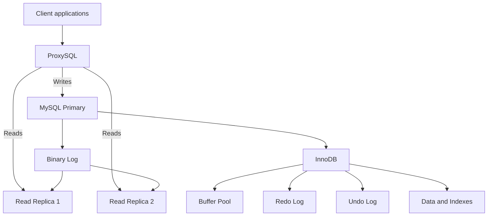
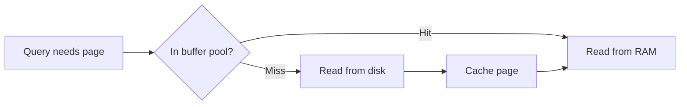
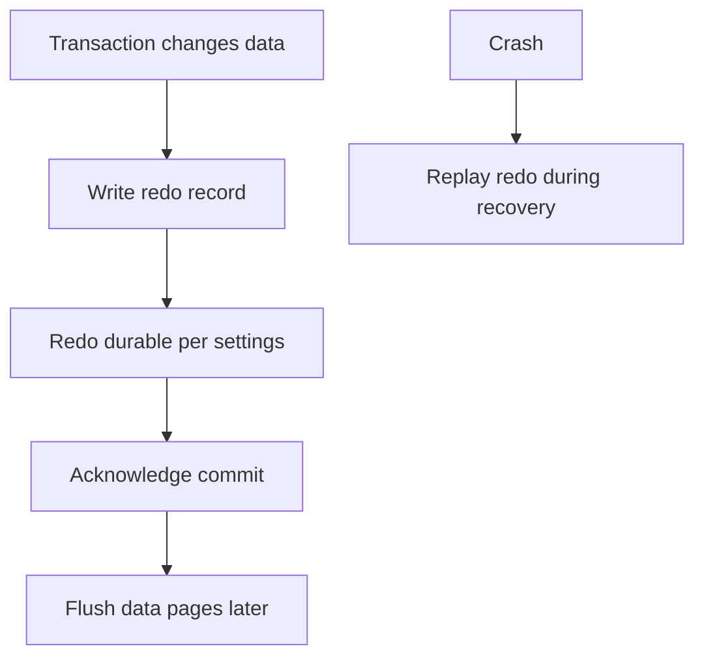
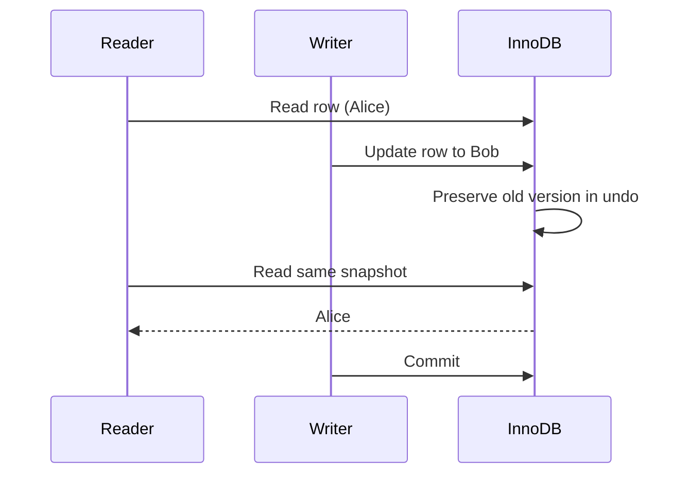
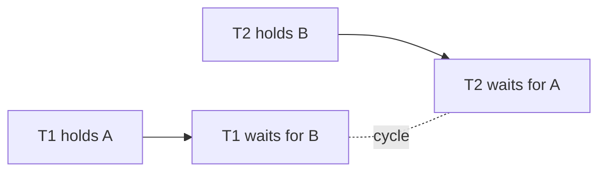
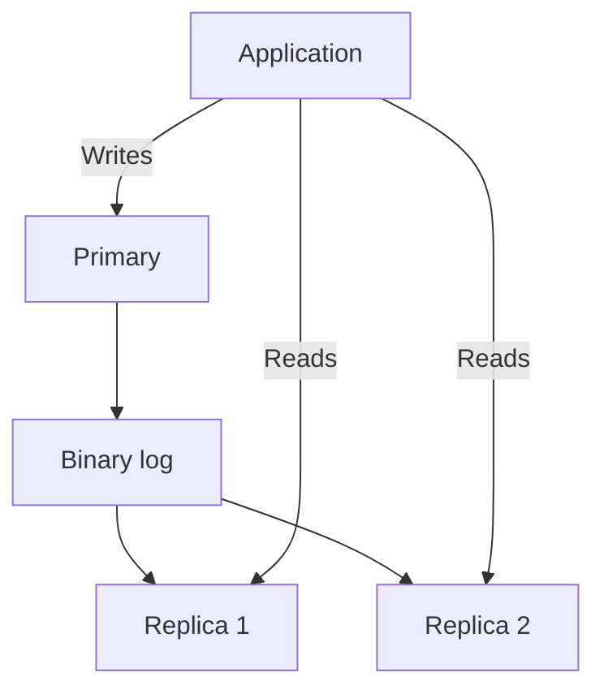
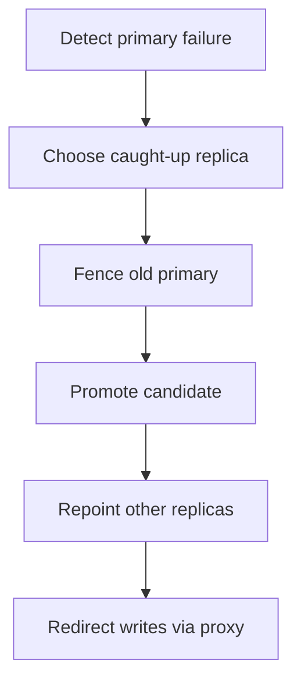
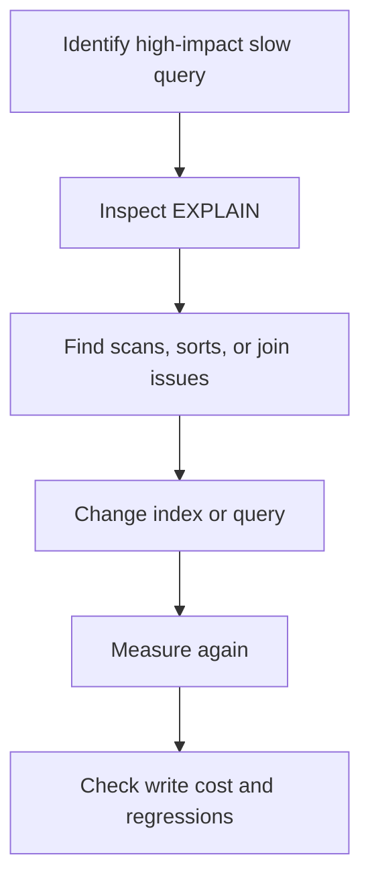

# MySQL Internals, Scaling, and System Design

**Author:** Jayesh Sharma  
**Study Library:** Database Notes

> Simplified study notes based on the supplied transcript. Key concepts and trade-offs are retained, with explanations and diagrams made easier to revise.

## 1. MySQL in a System Design

MySQL is a mature relational database, especially suitable for read-heavy workloads, related data, and ACID transactions. A common architecture has one write primary and multiple read replicas. Replicas scale reads; writes still go to the primary.

### Request path

- ProxySQL can manage connections and route reads/writes.
- The parser checks SQL syntax; the optimizer chooses a plan; the execution engine runs it.
- InnoDB handles transactional storage.
- Redo log supports crash recovery. Binary log carries replication events and supports point-in-time recovery.

## 2. When to Choose MySQL

Good fit:
- Read-heavy web apps, such as profiles and product catalogs.
- Relational data such as users, orders, and order items.
- ACID transactions, such as creating an order while reserving inventory.
- Teams with mature MySQL operations and expertise.

Consider alternatives for richer SQL/JSONB/geospatial features (PostgreSQL), document-shaped data (MongoDB), extreme write scale (Cassandra/ScyllaDB), or native horizontal write scaling (TiDB and other distributed systems). The best database depends on workload and operational requirements.

## 3. InnoDB vs MyISAM

InnoDB is recommended for modern transactional applications.

| Feature | InnoDB | MyISAM |
|---|---|---|
| Transactions | Yes | No |
| Locking | Row-level and other fine-grained locks | Table-level |
| Foreign keys | Yes | No |
| MVCC | Yes | No |
| Crash recovery | Yes | No |
| Typical use | Modern production systems | Legacy/specialized cases |

## 4. InnoDB Internals

### Buffer pool
The buffer pool caches data and index pages in RAM. A hit avoids disk I/O; a miss requires a slower disk read. Performance improves when the frequently used working set fits in memory.

InnoDB can also build an adaptive hash index over frequently accessed index pages.

### Redo log and doublewrite buffer
The redo log (write-ahead log) records changes so a committed transaction can be recovered even if data pages have not yet been flushed.

Sequential redo writes can be faster than random data-page writes. Flush settings trade throughput against durability risk. The doublewrite buffer stages pages before final writes to help recover from torn-page writes.

### Undo log and MVCC
When a row changes, InnoDB can preserve its previous version in undo. A reader can use a consistent snapshot while another transaction writes; readers and writers need not block each other for ordinary consistent reads.

Old versions remain while active transactions may need them.

### Clustered index and primary key
InnoDB stores actual rows in the leaf pages of the primary-key B+Tree. Secondary indexes contain indexed values and the primary key, so a secondary-index lookup may need a second lookup to fetch the full row.

| Primary-key choice | Advantage | Trade-off |
|---|---|---|
| Auto-increment integer | Compact, sequential inserts | Inserts cluster at the end |
| Random UUID | Globally unique | Larger and scattered inserts |
| Ordered UUID/ULID | Unique and roughly sequential | Larger than integer |
| Natural key | Meaningful | May be large or change |

## 5. Indexing Strategies

Indexes avoid scanning every row, but cost storage and slow writes because they must be maintained. Index based on actual query patterns.

### B+Tree and composite indexes
B+Tree indexes support equality and range queries. Linked leaf pages help range scans.

The leftmost-prefix rule: an index on (A, B, C) can support A, (A,B), and (A,B,C), but is generally not effective for B alone. Think of a phone book sorted by last name, then first name.

For “orders for a user, newest first,” an index such as (user_id, created_at) can match the query.

### Index quick guide

| Query pattern | Potential strategy |
|---|---|
| Equality filter | Index on the filter column |
| Equality plus range | Composite index; equality column first |
| ORDER BY | Include compatible sort columns |
| JOIN | Index join columns |
| Select only a few fields | Covering index may avoid table lookup |
| Modest text search | FULLTEXT; dedicated search engine for advanced needs |

A covering index contains every column needed by a query. EXPLAIN may report “Using index” when the query is covered.

Avoid too many indexes, low-selectivity indexes without a clear use, functions on indexed columns, leading-wildcard LIKE patterns, and SELECT * when columns are unnecessary. Use EXPLAIN before considering index hints.

## 6. Transactions, Isolation, and Locking

Isolation levels define what concurrent transactions can observe.

| Level | Dirty read | Non-repeatable read | Phantom read |
|---|---|---|---|
| READ UNCOMMITTED | Possible | Possible | Possible |
| READ COMMITTED | Prevented | Possible | Possible |
| REPEATABLE READ (default) | Prevented | Prevented | Controlled by snapshot/locking behavior |
| SERIALIZABLE | Prevented | Prevented | Prevented |

- Dirty read: see another transaction’s uncommitted change.
- Non-repeatable read: the same row changes between reads in one transaction.
- Phantom: new matching rows appear in a repeated range query.

InnoDB uses MVCC snapshots for ordinary reads under REPEATABLE READ. Locking reads and writes may use gap and next-key locks to protect ranges.

Lock types:
- Record lock: one index record.
- Gap lock: the gap between records; restricts inserts into it.
- Next-key lock: record plus adjacent gap.
- Table lock: table-wide.

SELECT ... FOR UPDATE is useful for inventory, seat booking, and other read-then-update workflows.

### Deadlocks
A deadlock occurs when two transactions hold locks the other needs.

InnoDB detects deadlocks and rolls back a victim. Reduce them by accessing rows in consistent order, keeping transactions short, indexing predicates, and retrying deadlock failures.

**Pessimistic locking** locks before update and suits frequent conflicts. **Optimistic locking** detects conflicts using a version field and suits rare conflicts, with retries when needed.

## 7. Replication and Read Scaling

The primary writes changes to its binary log. Replicas receive and apply those events and can serve reads, but may be behind the primary.

Replication sequence: primary writes and logs changes; replicas stream events, persist them, and apply them.

| Mode | Trade-off |
|---|---|
| Row-based | Avoids many statement replay correctness issues |
| Asynchronous | Low write latency; recent commits may be missing after primary failure |
| Semi-synchronous | Waits for at least one replica acknowledgment; adds latency and reduces loss risk |
| Group Replication | Coordinated high availability, with added complexity and write cost |

Lag may result from large transactions, sustained write load, slower replica hardware, or network limits.

Ways to handle lag:
- Read-your-writes: send a user's reads to primary briefly after their write.
- Causal consistency: wait until a replica reaches a required binlog position.
- Accept bounded staleness for feeds, analytics, and dashboards.

## 8. Failover

Failover is an orchestrated sequence, not merely a connection change.

GTIDs identify transactions consistently and simplify replication reconfiguration. The old primary must be reliably fenced or demoted: otherwise, both old and new primaries could accept writes, causing split-brain.

Asynchronous replication may lose commits not yet received by replicas. Semi-synchronous replication reduces that risk, depending on configuration and which replica is promoted. Tooling may include Orchestrator, InnoDB Cluster/MySQL Router, or managed database services.

## 9. Sharding

Replication primarily scales reads. Sharding partitions data and write traffic across database instances.

Consider it when data no longer fits comfortably on one server, one primary cannot sustain writes, replicas cannot keep up, or geographic placement is required.

| Method | Description | Trade-off |
|---|---|---|
| Range-based | Key ranges map to shards | Range queries are easy; skew/hotspots possible |
| Hash-based | Hash(key) selects shard | Often balanced; cross-shard ranges are harder |
| Directory-based | Mapping service/table selects shard | Flexible movement; directory is critical infrastructure |

A good shard key has high cardinality, even distribution, appears in common queries, and rarely changes. Examples: user_id for users, user_id for a user's orders, conversation_id for messages, tenant_id for multi-tenant data.

Design for single-shard queries. Cross-shard joins, transactions, and aggregations are more complex.

### Vitess and avoiding premature sharding
Vitess adds MySQL-aware routing, connection pooling, schema management, and resharding support.

Before sharding, try query/index tuning, vertical scaling, read replicas, caching hot data, and archiving cold data. Sharding adds long-term operational complexity; use it when the primary is demonstrably the bottleneck.

## 10. Query Optimization

Slow paths often come from a few costly queries: scans, large sorts, bad join plans, or retrieving too much data.

- EXPLAIN shows the estimated plan.
- EXPLAIN ANALYZE (MySQL 8.0.18+) executes the query and reports actual timing/plan details.
- Review type, possible_keys, key, rows, filtered, and Extra.
- ALL indicates a full table scan; investigate for large tables. The best plan depends on table size and selectivity.

Practical tips:
- Avoid retrieving unused columns.
- Make ORDER BY and LIMIT compatible with indexes where possible.
- Batch operations to reduce round trips.
- Consider keyset/cursor pagination instead of large offsets.
- Verify implicit conversions and OR rewrites with EXPLAIN; optimizer behavior varies.

## 11. MySQL vs Other Databases

| Alternative | MySQL may fit better when… | Alternative may fit better when… |
|---|---|---|
| PostgreSQL | Familiar operations and straightforward relational needs dominate | Rich SQL, JSONB, extensions, or geospatial features matter |
| MongoDB | Data is relational and transactional | Data is document-shaped and schema changes frequently |
| Cassandra | SQL flexibility and ACID are important | Fixed access patterns and very high write scale dominate |
| TiDB | One write primary is enough | Distributed SQL and horizontal write scale are required |

## 12. Interview Revision Checklist

Be ready to explain:
- Why MySQL suits the workload and data model.
- InnoDB, buffer pool, redo/undo logs, and MVCC.
- Clustered primary key and secondary-index lookup behavior.
- Composite and covering indexes.
- Isolation levels, locks, and deadlocks.
- Binlog replication, lag, and read-your-writes.
- Failover, GTIDs, fencing, and split-brain.
- Sharding methods and shard-key selection.
- How EXPLAIN helps optimize queries.

**Key takeaway:** MySQL is a dependable relational database for many read-heavy transactional systems. Understand InnoDB, indexing, replication lag, failover safety, and the single-primary write limit. Add complexity only when the requirements and measurements justify it.

---
*Source note: Based on the supplied transcript. Explanations and diagrams are simplified for study; the source’s main framing and trade-offs are retained.*
