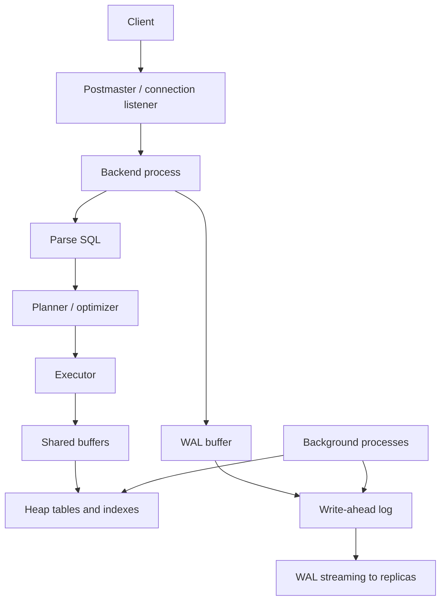
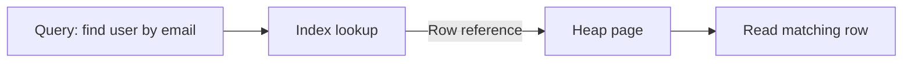
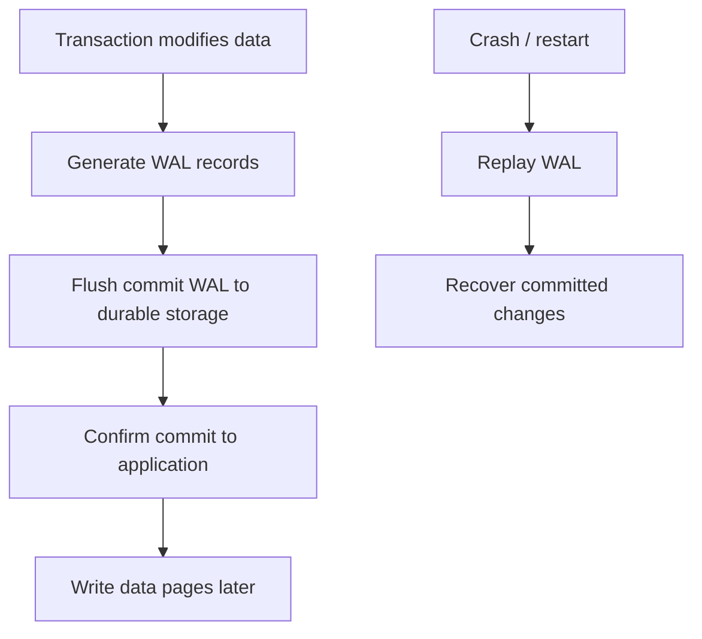
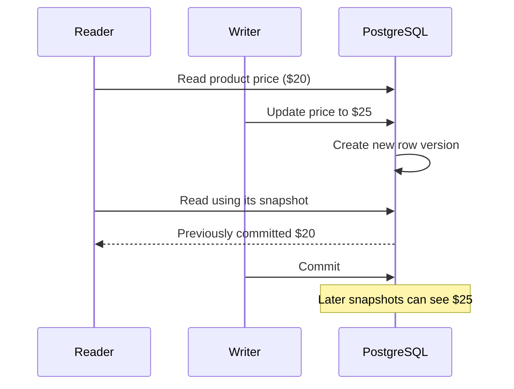
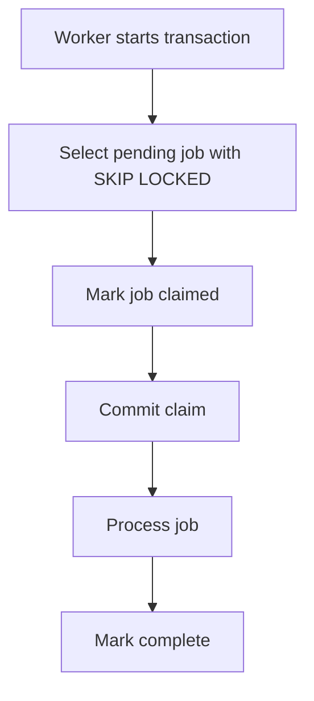
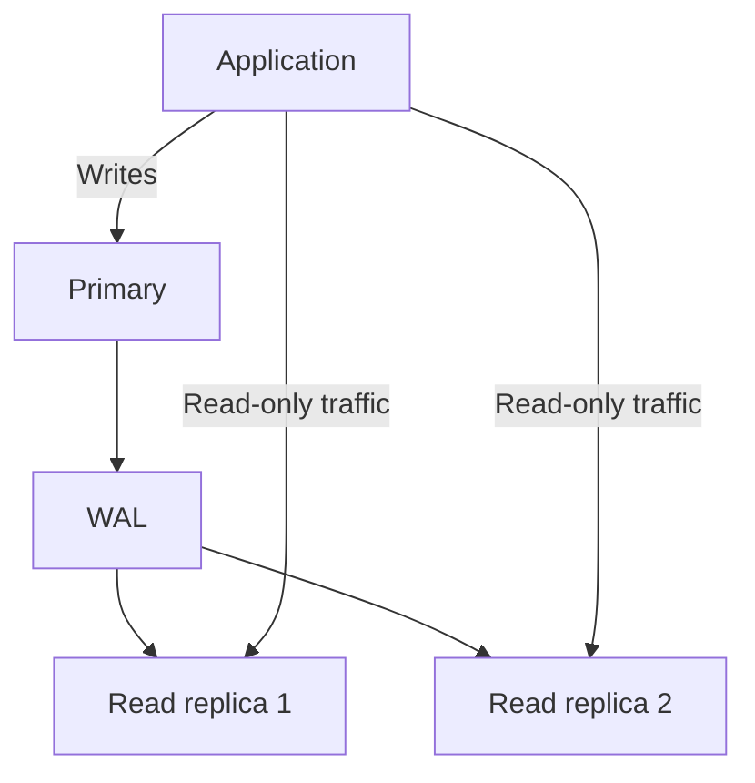

# PostgreSQL for System Design Interviews

**Author:** Jayesh Sharma  
**Study Library:** Database Notes

> Beginner-friendly notes based on the supplied transcript. Concepts are simplified, with practical examples, trade-offs, and Mermaid diagrams for revision.

## 1. When PostgreSQL Is a Good Choice

PostgreSQL is a strong choice when an application needs:
- Relationships between entities (customers, orders, products, payments).
- ACID transactions and strong consistency.
- Complex queries, joins, constraints, and flexible SQL.
- A mature relational database with managed-cloud options.

Examples include wallets and payments, ticket/room booking, and e-commerce.

## 2. PostgreSQL Architecture

The main server process (often called the postmaster) listens for connections. Traditionally, each client connection gets a backend operating-system process. Many direct connections therefore consume resources; connection poolers such as PgBouncer can reduce the number of database backends.

The backend parses SQL, the planner chooses a plan using indexes and statistics, and the executor runs it. Shared memory includes shared buffers and WAL buffers. Background processes support checkpoints, writes, cleanup, and replication.



Key background processes:
- **Checkpointer / background writer:** help write modified pages to storage.
- **WAL writer:** writes WAL records.
- **Autovacuum:** cleans up obsolete row versions and supports table health.
- **WAL sender:** streams WAL to replicas when replication is configured.

## 3. Heap Storage and Indexes

PostgreSQL typically stores table rows (tuples) in a heap, divided into pages. The default page size is 8 KB. Rows are not physically sorted by a key.

An index is a separate structure that stores indexed values and references to heap rows. A primary key automatically creates a unique index.



Indexes make lookups faster, but consume disk and add work to inserts, updates, and deletes. Choose them for real query patterns.

## 4. Transactions and WAL

A transaction groups operations so they succeed together or are rolled back together.

Example: transferring $100 from Alice to Bob must debit Alice and credit Bob atomically. If the transaction fails, neither change should remain committed.

PostgreSQL uses **write-ahead logging (WAL)**:
1. Changes generate WAL records.
2. WAL is made durable before the corresponding modified data pages are written.
3. On commit, PostgreSQL normally flushes the commit record to durable storage before acknowledging success.
4. Data pages can be written later by background processes.
5. After a crash, PostgreSQL replays WAL to recover committed changes.



Checkpoints establish recovery points so restart does not need to replay the entire log. WAL also supports replication and point-in-time recovery.

## 5. MVCC: Multi-Version Concurrency Control

PostgreSQL does not simply overwrite a row in place for every update. It creates a new row version. A transaction uses a snapshot to determine which versions are visible.

A reader can often see an older committed version while a writer changes the row. This improves read/write concurrency, but concurrent writers to the same row can still block.



The older versions are not immediately removed because active transactions may still need them. This leads to VACUUM.

## 6. VACUUM, Autovacuum, and Bloat

Updates and deletes leave obsolete row versions (dead tuples). **VACUUM** makes their space reusable once no active snapshot needs them. **Autovacuum** performs cleanup automatically based on table activity and configured thresholds.

Regular VACUUM usually makes space reusable within the table, but does not necessarily return it to the operating system. If cleanup cannot keep up, tables and indexes may accumulate **bloat**—extra space that can also increase I/O.

Long-running transactions can prevent old versions from being cleaned up.

For high-frequency data such as driver locations, consider storing the latest position in Redis and periodically persisting durable snapshots/history to PostgreSQL, depending on product requirements.

## 7. Isolation Levels

Isolation levels define how transactions see concurrent changes.

| Isolation level | Snapshot behavior / guarantee |
|---|---|
| Read Committed (default) | Each statement gets a fresh snapshot; repeated queries can see newly committed data |
| Repeatable Read | Transaction uses a stable snapshot; conflicting concurrent updates may cause a serialization error |
| Serializable | PostgreSQL detects dangerous dependency patterns and aborts a transaction when needed to preserve serializable behavior |

Applications must be prepared to retry transactions aborted due to serialization failures. Read Committed is sufficient for many workloads, but application logic must still handle concurrency correctly.

## 8. Lost Updates and Safe Concurrent Changes

A **lost update** occurs when two requests read the same old value, calculate changes in application code, and overwrite each other.

Example: balance is $500. Two concurrent $100 withdrawals both read $500 and both write $400. Correct balance should be $300.

### Option A: Atomic conditional update

```sql
UPDATE accounts
SET balance = balance - 100
WHERE account_id = 42
  AND balance >= 100;
```

The database updates the current value under row locking. Check affected-row count: one row means success; zero rows means the account was missing or funds were insufficient.

### Option B: SELECT FOR UPDATE

Lock the row before reading and deciding. The lock is held until transaction end. Useful for multi-step decisions that depend on the current value.

### Option C: Optimistic concurrency

Store a version number. Update only if the version still matches; if no row changes, reload and retry after rechecking business rules.

## 9. PostgreSQL as a Job Queue

For moderate workloads, a jobs table can be used with FOR UPDATE SKIP LOCKED. Workers skip jobs already claimed by another worker and select different available jobs.



For short database-only jobs, claim, process, and mark complete can sometimes be handled in one transaction. For long tasks, claim in a short transaction and process separately. Use a lease/timeout so crashed workers do not hold jobs forever. Make job handling idempotent because retries can run work more than once.

A dedicated queue (such as Kafka, RabbitMQ, or a managed queue) may be more appropriate as job volume and worker count grow.

## 10. Constraints Protect Data Integrity

Constraints make business rules enforceable by the database—not just by application code.

Common examples:
- **PRIMARY KEY:** uniquely identifies a row.
- **UNIQUE:** prevents duplicate values, including combinations such as (show_id, seat_id).
- **FOREIGN KEY:** ensures a reference points to an existing row.
- **NOT NULL:** requires a value.
- **CHECK:** validates a condition, such as quantity > 0.

For booking systems, a unique constraint on (event_id, seat_id) can prevent two users from reserving the same seat, even if requests race.

## 11. Replication and High Availability

PostgreSQL can stream WAL from a primary to replicas. Replicas can serve reads and support recovery, but asynchronous replicas may lag.



Trade-offs:
- **Asynchronous replication:** lower write latency, but recent commits may not yet exist on a replica.
- **Synchronous replication:** can improve durability guarantees but adds latency and depends on configuration.
- Read-your-writes requirements may route a user's immediate reads to the primary or wait until a replica catches up.
- Failover requires choosing a suitable replica and preventing the old primary from continuing to accept writes (split-brain protection).

## 12. Scaling PostgreSQL

A practical scaling progression:

1. Measure and optimize slow queries.
2. Add or adjust indexes based on query plans.
3. Tune connection pooling and resource usage.
4. Scale vertically when CPU, memory, or storage is the limit.
5. Add read replicas for read-heavy traffic, accounting for lag.
6. Cache frequently requested data when stale data is acceptable.
7. Partition very large tables when it helps manage data and query access.
8. Consider sharding only when one primary is a demonstrated write or storage bottleneck.

Sharding adds complexity to routing, cross-shard joins, transactions, and operations. Avoid it until simpler approaches are insufficient.

## 13. PostgreSQL Extensions: Search and Vector Similarity

PostgreSQL can support more than ordinary relational queries:
- **Full-text search:** tsvector and tsquery tokenize and search text; GIN indexes can accelerate matching.
- **pgvector:** stores embeddings and supports vector similarity queries. Approximate nearest-neighbor indexes such as HNSW can speed up searches as vector collections grow.

These features can reduce the need for a separate search or vector system for some workloads. Evaluate scale, latency, ranking needs, and operational requirements before consolidating.

## 14. System Design Interview Checklist

When proposing PostgreSQL, explain:
- Why relational data, constraints, transactions, and SQL suit the problem.
- How backend processes, shared buffers, planner, executor, and background processes fit together.
- How heap pages and indexes locate rows.
- How WAL ensures crash recovery and supports replication.
- How MVCC and snapshots allow concurrent reads and writes.
- Why VACUUM/autovacuum matter and how long transactions can cause bloat.
- How isolation levels and atomic updates prevent concurrency errors.
- How constraints prevent duplicate bookings and invalid references.
- How to use replicas, manage lag, and protect failover.
- How to scale progressively without sharding too early.

**Key takeaway:** PostgreSQL combines relational modeling, strong transactional guarantees, flexible SQL, and useful extensions. Understand MVCC, WAL, vacuuming, isolation, constraints, and replication to design reliable systems.

---
*Source note: Based on the supplied PostgreSQL transcript. The examples and diagrams are simplified for study and interview revision.*
