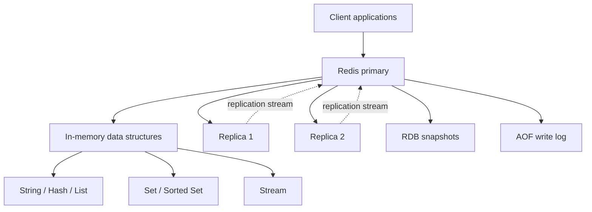
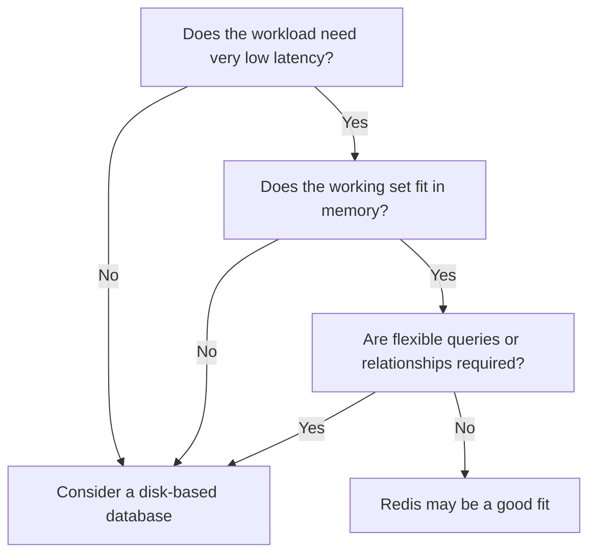
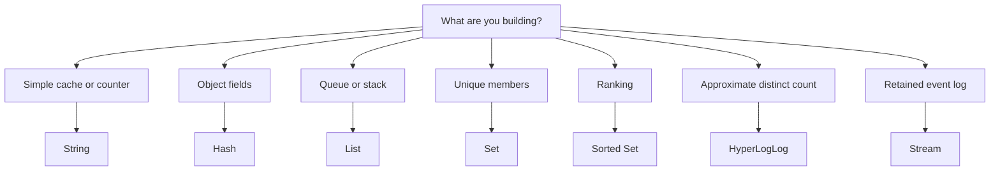
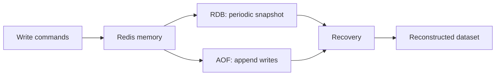
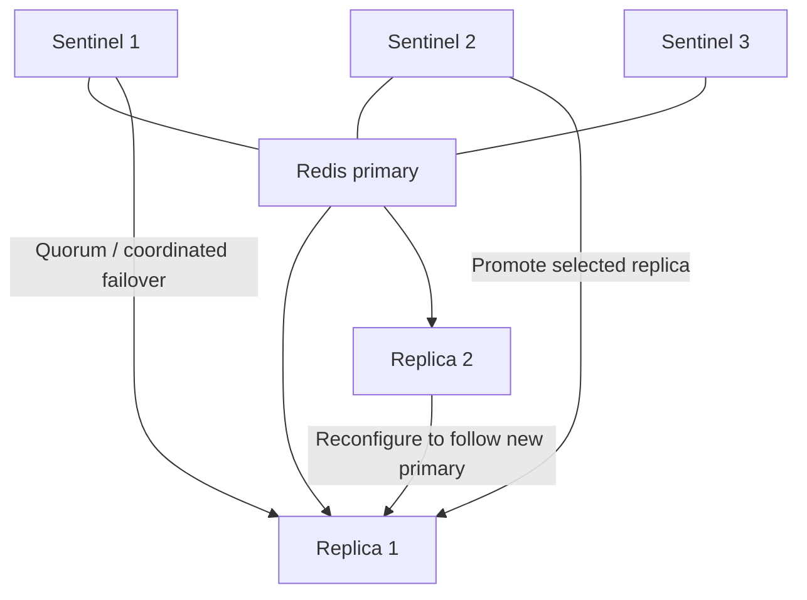
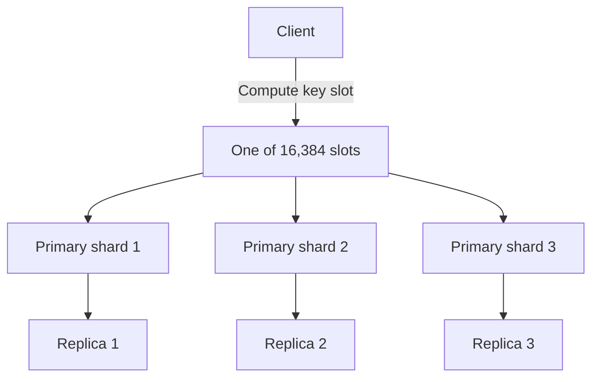
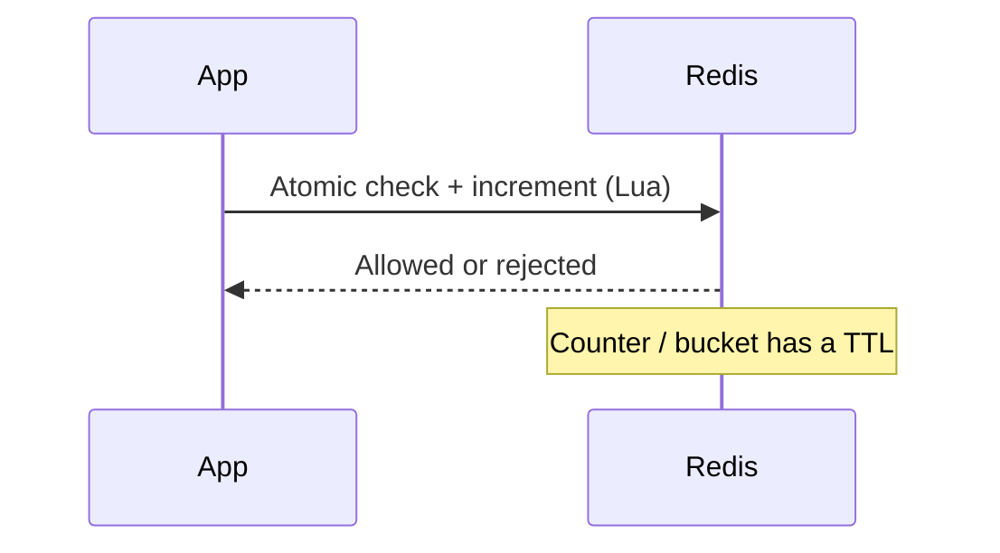
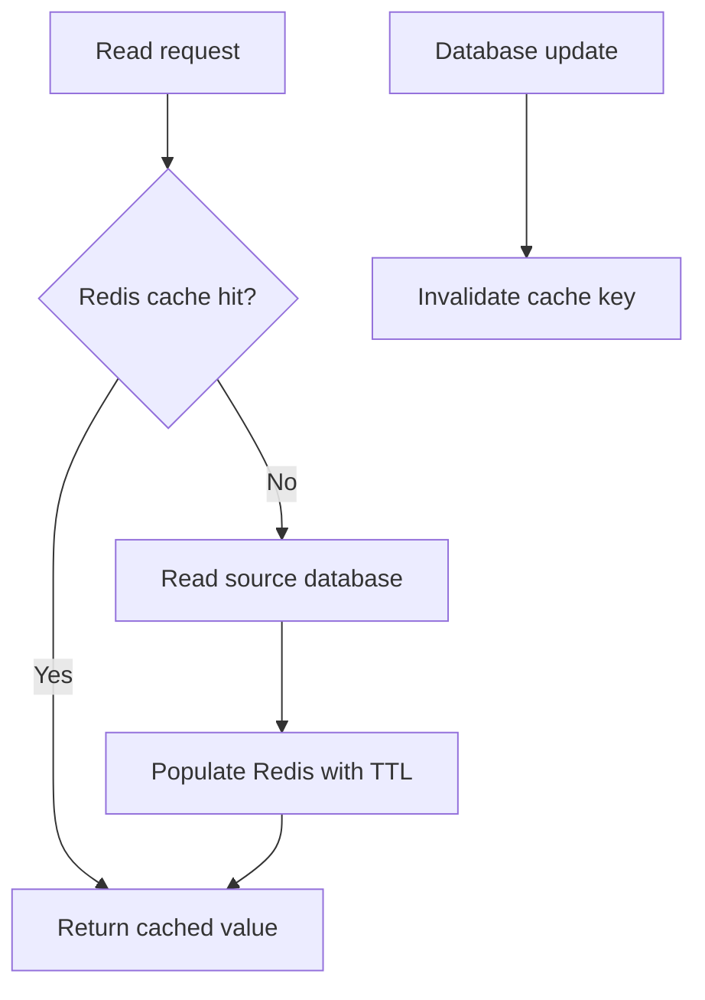

# Redis for System Design Interviews

> Distributed Systems Study Library · Author: Jayesh Sharma

Redis is a strong fit when a system needs low-latency shared state: caches, sessions, rate limiters, leaderboards, and small pieces of real-time application state. The important interview question is not simply “Why Redis is fast?” but **which Redis feature matches the access pattern, and what trade-off does the design accept?**

## 1. Redis at a glance

Redis keeps its working data in memory and offers structures such as Strings, Lists, Sets, Sorted Sets, Hashes, HyperLogLog, and Streams. Many commands are O(1) or O(log N), depending on the operation and data structure.

The primary commonly processes commands through an event loop, multiplexing many client connections and executing commands sequentially. Redis also supports threaded I/O in some configurations and versions; avoid oversimplifying this as “Redis is entirely single-threaded.”

**Trade-off:** in-memory speed costs RAM. Persistence and replication improve recovery and availability, but do not automatically make Redis equivalent to a strongly durable primary database.

## 2. When to choose Redis

| Requirement | Why Redis can fit |
|---|---|
| Low latency | Working set is in memory |
| Frequently read data | Cache reduces database work |
| Rate limiting | Atomic increments and TTL |
| Rankings | Sorted Sets maintain score order |
| Sessions | Fast key lookup and expiration |
| Broadcast updates | Pub/Sub delivers to active subscribers |
| Coordination | Atomic commands/scripts can implement limited coordination patterns |

Redis is a weaker fit for ad-hoc queries, joins, complex relationships, data that cannot fit in memory, or critical records that must not be lost. Keep a durable database as the source of truth when appropriate; use Redis as a cache or derived-state store.

## 3. Core data structures

| Structure | Good fit | Typical operation characteristics |
|---|---|---|
| String | Cache value, counter, token | GET/SET and INCR typically O(1) |
| Hash | Object fields, profile/session attributes | Single-field access typically O(1); HGETALL is O(N) |
| List | FIFO queue, recent items | Push/pop at ends typically O(1); index access O(N) |
| Set | Unique items, membership, intersections | Add/remove/check typically O(1); full enumeration O(N) |
| Sorted Set | Leaderboard, ranked/time-scored items | Add/rank O(log N); range query O(log N + M) |
| HyperLogLog | Approximate distinct count | Fixed-size structure (about 12 KB); standard error about 0.81% |
| Stream | Retained event log and consumer groups | Append/read entries with IDs and consumer-group acknowledgments |
| Pub/Sub | Live broadcast | Fire-and-forget; no persistence or replay |

Example interview framing: “I’ll use a Sorted Set for the leaderboard: player ID is the member, score is the sort score, and rank/range commands support top-N queries. I’ll monitor memory and hot-key pressure as it grows.”

## 4. Persistence: RDB and AOF

Redis data is in memory; persistence determines what can be recovered after restart.

### RDB snapshots
- Saves a point-in-time binary snapshot.
- Useful for backups and relatively fast restarts.
- May lose writes made after the last snapshot.
- Snapshotting uses a child process and copy-on-write; fork cost and memory pressure can cause latency spikes.

### AOF (Append-Only File)
- Records write operations and replays them during recovery.
- `appendfsync always`: stronger disk-flush behavior, typically slower.
- `appendfsync everysec`: common compromise; roughly up to one second of writes may be lost in a crash.
- `appendfsync no`: OS decides when to flush; least predictable durability.
- AOF rewrite compacts history into commands that recreate current state.

RDB and AOF can be combined: snapshot-like data supports faster loading, while subsequent AOF entries capture newer writes. Actual recovery and loss behavior depends on configuration and storage.

| Strategy | Typical trade-off |
|---|---|
| No persistence | Fastest, all state lost on restart |
| RDB | Fast recovery; may lose changes since snapshot |
| AOF everysec | Better durability; possible ~1 second loss; replay may take longer |
| AOF always | Stronger flush policy, higher write cost |
| RDB + AOF | Balances recovery speed and durability |

Choose persistence based on the consequence of losing data. A rebuildable cache can tolerate weaker persistence; irreplaceable financial/order data should not rely solely on Redis.

## 5. Replication and high availability

Redis primary-replica replication is normally asynchronous. The primary handles writes and streams updates to replicas. Replicas may serve reads, but can be stale due to replication lag. A primary failure before a write reaches a replica can result in that write being lost during failover.

The `WAIT` command can wait for replicas to acknowledge prior writes, reducing some failover-loss risk, but it is not a full durable commit guarantee.

### Sentinel
Sentinel monitors Redis nodes, coordinates failover, promotes a replica, and helps clients discover the current primary. Deploy multiple Sentinels (commonly 3 or 5) to make failure decisions.

Failover is not instantaneous. Applications should handle a brief period of failed or retried requests and use Sentinel-aware clients when applicable. Sessions may be recoverable through re-authentication; the consequence differs for every use case.

## 6. Redis Cluster and horizontal scaling

Redis Cluster partitions the keyspace across **16,384 hash slots**. A key maps to a slot using CRC16 and modulo 16384; primaries own ranges of slots and may have replicas for failover.

If a client contacts the wrong node, Redis can return a `MOVED` redirect. Smart clients cache slot-to-node mappings.

### Hash tags and multi-key operations
In Cluster, multi-key operations, transactions, and Lua scripts generally require all involved keys to be in the same slot. A hash tag—text inside braces—forces keys to hash using the tagged substring, e.g. `cart:{user42}:items` and `cart:{user42}:meta`.

This enables same-slot atomic operations but can concentrate traffic if too many keys share one tag.

### Sentinel vs Cluster

| | Sentinel | Redis Cluster |
|---|---|---|
| Primary goal | High availability | High availability plus horizontal scaling |
| Data capacity | One primary’s memory | Aggregate memory across shards |
| Multi-key operations | Broad single-node support | Generally same-slot only |
| Complexity | Lower | Higher |

Evenly distributing keys does not guarantee evenly distributed traffic. A very popular key can overload one shard. Mitigations include short-lived application-local caching, replica reads (accepting staleness), splitting hot counters into subkeys, or duplicating read-only values across keys.

## 7. Memory management and eviction

Set `maxmemory` and choose an eviction policy deliberately.

| Policy | Behavior |
|---|---|
| `noeviction` | Reject writes when memory limit is reached |
| `allkeys-lru` / `allkeys-lfu` | Evict least-recently / least-frequently used key from all keys |
| `volatile-lru` / `volatile-lfu` | Evict among keys with TTL |
| `allkeys-random` / `volatile-random` | Random eviction |
| `volatile-ttl` | Evict keys with the shortest TTL |

LRU favors recently accessed data; LFU favors frequently accessed data. LFU can protect consistently popular keys from one-off scans, while LRU is a reasonable general cache starting point. Monitor memory use, evictions, hit rate, latency, and rejected writes.

## 8. Common Redis patterns

### Distributed locks
Acquire a lock with an atomic `SET key token NX EX ttl`. Release it only if the stored token matches the owner token—use a short Lua script for atomic check-and-delete. A lease can expire while work is still running, and a failover can lose lock state. For correctness-critical coordination, consider fencing tokens or a consensus-backed/database mechanism.

### Rate limiting
- **Fixed window:** counter per identity and time bucket; atomic `INCR` plus TTL. Set expiry safely, often with Lua. Simple, but requests can burst across window boundaries.
- **Sliding window:** sorted set of request timestamps; remove old entries, count current-window entries, then add the request atomically.
- **Token bucket:** tracks tokens and refill time; permits bounded bursts while controlling average rate.

### Leaderboard
Use a Sorted Set: member = player ID, score = points. Update score and query rank/top-N using sorted-set commands.

### Session store
Use a key or Hash with an expiration. Redis provides fast access and automatic expiry; design for re-authentication or session recovery if Redis is unavailable.

### Cache-aside
1. Read Redis.
2. On a hit, return cached data.
3. On a miss, read the source database, populate Redis with a TTL, and return.
4. On database updates, update the database and invalidate the cache key.

Deleting on write is often safer than directly overwriting the cache, though races can still briefly reintroduce stale data. TTLs bound stale lifetime.

Cache stampede mitigations:
- Single-flight/per-key lock so one request refreshes the value.
- TTL jitter to spread expirations.
- Early/background refresh for hot keys.
- Serve stale data briefly when the product allows it.

### Pub/Sub vs Streams
Pub/Sub is immediate broadcast but messages can be lost when subscribers are disconnected. Streams retain entries and support consumer groups and acknowledgments. For long retention, high-throughput replayable event pipelines, Kafka may be more appropriate.

## 9. Transactions and Lua

- `MULTI/EXEC` queues commands and executes them without interleaving from other clients, but Redis transactions do not provide database-style rollback: a runtime command error does not undo other commands.
- `WATCH` supports optimistic concurrency; clients retry when watched keys change.
- Lua scripts run atomically on one Redis node and support read/decide/write logic in one round trip. Keep scripts short: they block other commands while running. In Cluster, keys touched by a script must be in the same slot.

Use Lua for atomic rate-limit checks, lock acquisition/release, and small quota updates.

## 10. Redis compared with alternatives

| Technology | Prefer it when |
|---|---|
| Redis | Low-latency derived state, data structures, cache, rate limits, sessions |
| Memcached | Simple key/blob cache; multithreaded high-QPS get/set may fit |
| DynamoDB | Durable managed key-value/document primary store |
| Kafka | Large-scale event streaming, retention, and replay |
| Database buffer pool | Database’s own hot pages; Redis can still offload app-level reads and return pre-shaped values |

Redis and a durable database often complement each other rather than replace each other.

## Interview checklist

When proposing Redis, explain:
1. Which access pattern and data structure fit?
2. Does the working set fit in RAM, and what is the memory budget?
3. Is Redis a cache, derived state, or the source of truth?
4. What persistence policy matches acceptable data loss?
5. What happens during replica lag, failover, eviction, or an outage?
6. How are cache invalidation and stampedes handled?
7. Does the design need Sentinel or Cluster, and are there hot keys?
8. What requires atomicity, and can it be done with a short Lua script?

**Key takeaway:** Redis is not simply “fast.” A strong design names the structure, maps it to the workload, and states the memory, durability, consistency, and failure trade-offs.

---
*These notes are based on the provided Redis material, reorganized into interview-focused study notes. Examples and diagrams are explanatory aids.*
