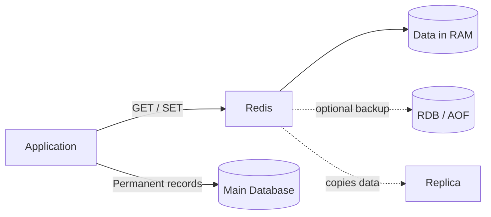
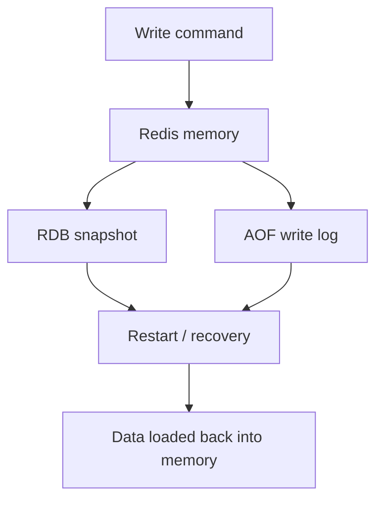
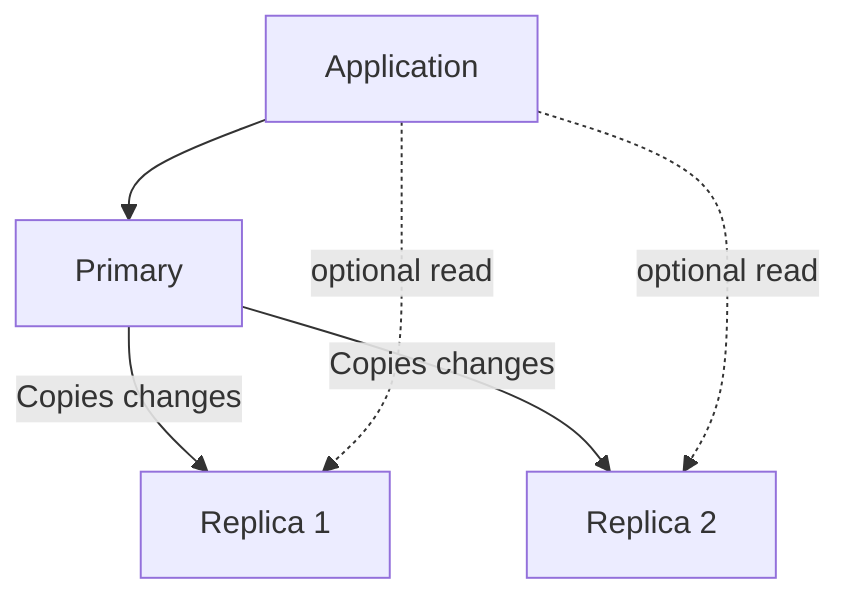
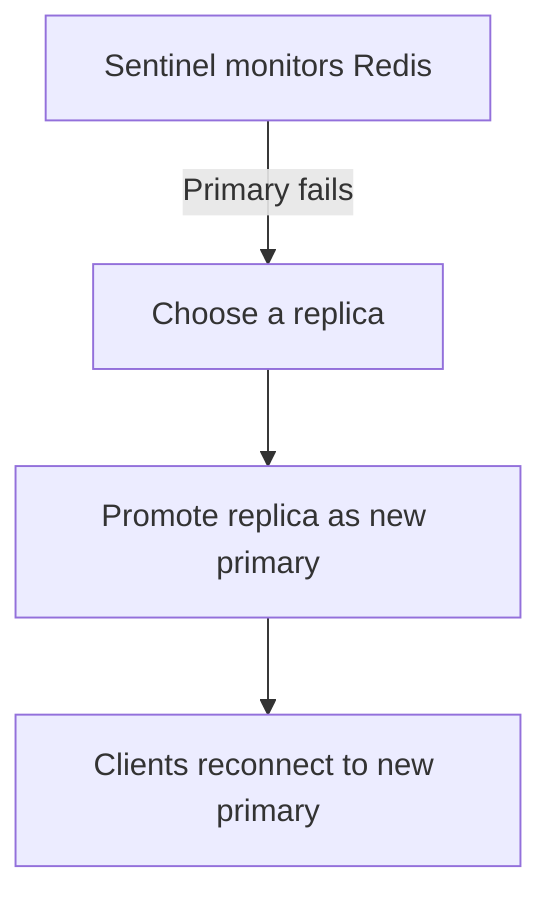
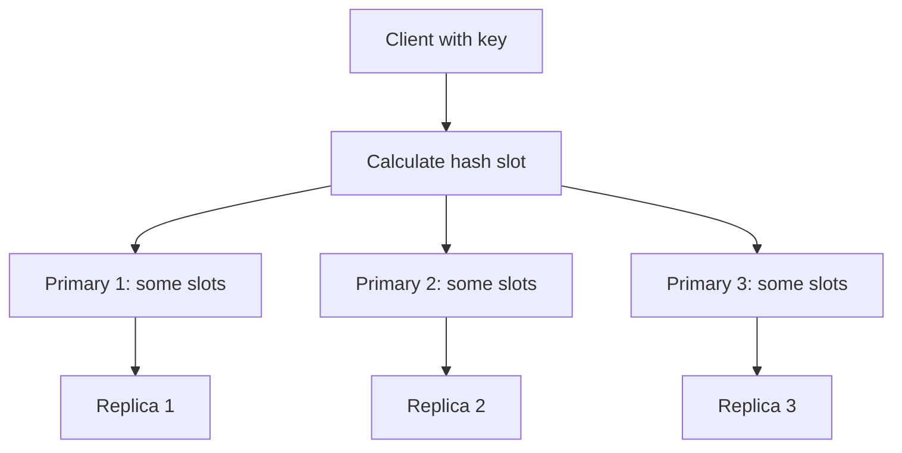
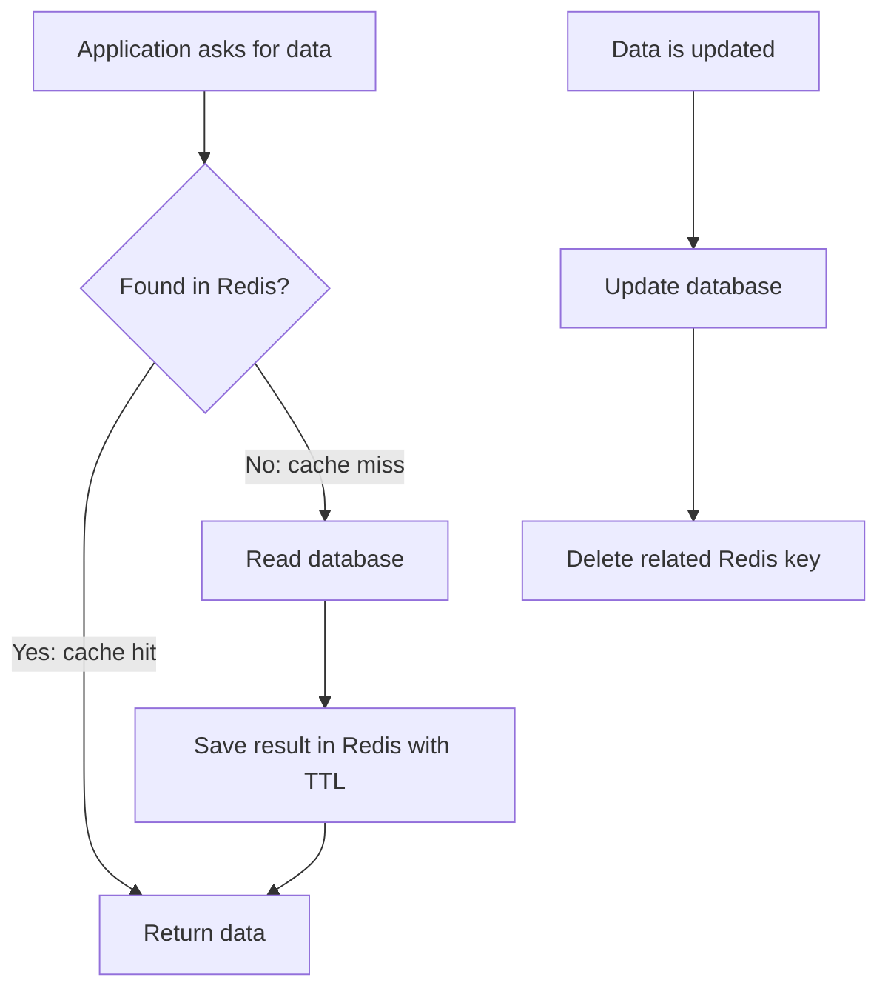

# Redis for System Design Interviews

> Distributed Systems Study Library · Author: Jayesh Sharma

Redis is an **in-memory data store**. It keeps frequently used data in RAM so applications can read and update it quickly.

Think of Redis as a **fast helper beside your main database**:

- Database: keeps the permanent, complete record.
- Redis: keeps data that the application needs quickly.

Common uses: caching, sessions, counters, rate limiting, leaderboards, and short-lived application state.

## 1. Redis in one picture



**Remember:** RAM gives speed. Disk gives recovery. Replicas help availability. They solve different problems.

Redis processes commands quickly because its main data is in memory. Its command execution is largely single-threaded per shard, while modern Redis can use I/O threads for some network work. So avoid saying that every part of Redis is single-threaded.

## 2. When should we use Redis?

Use Redis when the application needs:

- **Fast reads:** cache product details or user profiles.
- **Fast counters:** count views, likes, or API requests.
- **Expiry:** automatically remove old sessions or cache entries.
- **Ranking:** show top players or trending items.
- **Shared temporary state:** share session or rate-limit data across app servers.

Do not choose Redis as the only store when the data must be permanently safe, needs complex joins, or needs flexible queries. Keep important permanent records in a database.

**Easy rule:** If data is frequently used, small enough for memory, and can be rebuilt or safely managed, Redis may be a good fit.

## 3. Redis data structures — choose by the job

| Need | Redis structure | Easy way to remember |
|---|---|---|
| One value or counter | String | A simple value |
| Fields of one object | Hash | A small dictionary |
| Ordered items / queue | List | Items in a line |
| Unique items | Set | No duplicates |
| Ranking / score order | Sorted Set | A scoreboard |
| Approximate unique count | HyperLogLog | Count without storing every item |
| Retained events | Stream | A small event log |
| Live broadcast | Pub/Sub | Radio broadcast |

### Simple examples

- **String:** `user:42:name = "Asha"`
- **Hash:** `user:42 = {name: "Asha", city: "Pune"}`
- **List:** recent notifications or a simple queue.
- **Set:** users who liked a post; a user appears only once.
- **Sorted Set:** player IDs ordered by score.
- **HyperLogLog:** estimate how many different visitors opened a website.
- **Stream:** keep events so consumers can read and acknowledge them.
- **Pub/Sub:** send a live message to subscribers who are connected now.

**Memory trick:** Value, Object, Line, Unique, Ranking, Estimate, Event log, Broadcast.

## 4. Expiry and TTL

TTL means **Time To Live** — how long a key should live.

Example: a login session may expire after 30 minutes.

```text
SET session:42 "user data"
EXPIRE session:42 1800
```

After 1,800 seconds (30 minutes), Redis can remove the key automatically.

TTL is useful for sessions, temporary codes, and cache entries. It is not a replacement for a deliberate data-retention policy.

## 5. Persistence — what happens after restart?

Redis works mainly in memory. If the server stops, memory is lost. Persistence saves data so Redis can rebuild it after restart.

There are two main options:

### RDB = Snapshot

Redis saves a picture of the data at a point in time.

- Good for backups and faster recovery.
- Changes made after the last snapshot may be lost.
- Creating snapshots can use extra CPU and memory.

**Remember RDB as a photograph:** it shows the data at one moment.

### AOF = Write log

Redis records write commands in a file and replays them during recovery.

- Usually loses less recent data than periodic snapshots.
- Recovery can take longer because commands must be replayed.
- The fsync setting controls how often data is flushed to disk.

Common settings:

| Setting | Simple meaning |
|---|---|
| `appendfsync always` | Flush every write; safer, slower |
| `appendfsync everysec` | Flush about once per second; common compromise |
| `appendfsync no` | Let the operating system decide; less predictable |

With `everysec`, roughly the latest second of writes may be lost in a crash.

**Remember:** RDB = snapshot. AOF = write history. Redis can use both.



Choose based on how much data loss your application can accept. For critical financial or order records, use a durable database as the source of truth rather than relying only on Redis.

## 6. Replication — keep copies of data

A primary handles writes. Replicas receive copies of the primary's data and can sometimes serve reads.



Why use replicas?

- Help serve more read traffic.
- Keep copies that may be promoted if the primary fails.

Important: replication is normally **asynchronous**. A replica may be slightly behind the primary. A read from a replica can therefore return old data. If the primary fails before a write is copied, that write may be lost during failover.

**Remember:** Replication gives copies, not a guarantee that every write is safely stored everywhere.

## 7. High availability — Sentinel

Sentinel watches the primary and replicas. If the primary fails, Sentinel helps select and promote a replica.



Use multiple Sentinel processes so one failed monitor does not make the decision alone. Three is a common small deployment.

Failover takes time. Applications must be ready to retry requests and reconnect.

**Remember Sentinel = monitor + failover.**

## 8. Scaling data — Redis Cluster

One Redis server has limited memory and processing capacity. Redis Cluster spreads keys across multiple primary nodes.

Redis Cluster divides the keyspace into **16,384 hash slots**. Each primary owns some slots. A key is mapped to a slot, and the client sends the request to the node that owns it.



If the client contacts the wrong node, Redis can reply with a `MOVED` redirect. Cluster-aware clients learn which node owns each slot.

### Sentinel vs Cluster

| | Sentinel | Cluster |
|---|---|---|
| Main purpose | High availability | Sharding + high availability |
| Splits data across primaries? | No | Yes |
| Complexity | Simpler | More complex |
| Use when | One primary's capacity is enough | Data or traffic needs multiple shards |

**Remember:** Sentinel watches one primary group. Cluster divides the data across multiple primaries.

### Hash tags

In Cluster, keys used together in a multi-key operation generally need to be in the same hash slot.

A hash tag forces related keys into the same slot:

```text
cart:{user42}:items
cart:{user42}:details
```

Both keys use `user42` to calculate the slot.

Be careful: putting too much traffic under one hash tag can create a hot shard.

## 9. Memory limit and eviction

RAM is not unlimited. Set a memory limit and decide what Redis should do when it reaches that limit.

Eviction means **removing keys to make room for new data**.

| Policy | Simple meaning |
|---|---|
| `noeviction` | Do not remove keys; reject new writes when memory is full |
| `allkeys-lru` | Remove a key that was not used recently |
| `allkeys-lfu` | Remove a key used least often |
| `volatile-lru` | Apply LRU only to keys that have an expiry |
| `volatile-lfu` | Apply LFU only to keys that have an expiry |
| `volatile-ttl` | Prefer keys with the shortest remaining TTL |
| `allkeys-random` / `volatile-random` | Remove a random eligible key |

- **LRU:** Least Recently Used — “What has not been used lately?”
- **LFU:** Least Frequently Used — “What is rarely used?”

For a general cache, LRU is a reasonable starting point. LFU can help when a small group of keys is consistently popular.

Monitor memory, evictions, cache hit rate, latency, and rejected writes.

## 10. Common Redis design patterns

### A. Cache-aside — most common cache pattern

The application checks Redis first. If the value is missing, it reads the database and puts the result in Redis.



Steps to remember:

1. Check Redis.
2. If found, return it.
3. If missing, read the database.
4. Save the result in Redis with a TTL.
5. When data changes, update the database and invalidate the cache.

Why delete the cache after a database update? It is often simpler than trying to keep two copies perfectly synchronized. A short stale-data window can still happen, so use TTLs and suitable consistency rules.

**Cache stampede:** Many requests find the same key missing or expired and all hit the database together.

Ways to reduce it:
- Let one request refresh a key while others wait briefly.
- Add random variation to TTLs (TTL jitter).
- Refresh popular keys in the background.
- Serve slightly old data if the application allows it.

### B. Rate limiter

A rate limiter controls how many requests a user can make in a time period.

Example: allow 100 API requests per minute per user.

Redis is useful because many application servers can share the same counter.

Common approaches:

| Algorithm | Easy explanation | Trade-off |
|---|---|---|
| Fixed window | Count requests in each time bucket | Simple; can allow a burst at the boundary |
| Sliding window | Count requests in the last rolling period | More accurate; more work |
| Token bucket | Refill tokens over time; each request uses one | Allows controlled bursts |

Use atomic Redis operations or a short Lua script so two application servers do not incorrectly update the same limit at the same time.

### C. Distributed lock

A lock allows only one worker to enter a critical section at a time.

A common Redis pattern is:

```text
SET lock:order:42 unique-token NX EX 30
```

- `NX`: create the lock only if it does not exist.
- `EX 30`: give it a 30-second expiry.
- `unique-token`: identifies the owner.

Release the lock only if the stored token still matches your token. Use a short Lua script to check and delete atomically.

**Important:** A lock can expire while the original worker is still running. Failover can also lose lock state. For correctness-critical work, consider fencing tokens or a stronger coordination mechanism.

### D. Leaderboard

Use a Sorted Set.

- Member = player ID.
- Score = player points.
- Redis keeps members ordered by score.

This makes it easy to update a score and ask for the top players or a player's rank.

### E. Session store

Store a session ID and its data in Redis with an expiry.

All application servers can read the same session. If Redis is unavailable or session data is lost, the application should have a recovery or re-login plan.

## 11. Pub/Sub vs Streams

Both help applications communicate, but they solve different problems.

| Pub/Sub | Streams |
|---|---|
| Live broadcast | Retained event entries |
| Subscriber must be listening | Consumer can read later |
| No message history or replay | Supports reading and replaying retained entries |
| Good for live notifications | Good for work/event processing |

**Remember:**

- Pub/Sub = radio: miss the broadcast and it is gone.
- Streams = logbook: events are kept so consumers can read them later.

For large event pipelines with long retention and extensive replay needs, Kafka may be a better fit.

## 12. Transactions and Lua scripts

Redis supports ways to group operations and avoid interference from other clients.

- **MULTI / EXEC:** queue commands and execute them together without another client's commands running in between. This is not the same as a relational database transaction with rollback.
- **WATCH:** watch keys; if another client changes one, the transaction can be retried.
- **Lua script:** run a small group of Redis operations atomically on a node.

Use a short Lua script when a decision and update must happen together, such as checking a rate limit and incrementing its counter.

Keep scripts short because they block other commands on that Redis node while running. In Cluster, keys touched by a script must be in the same slot.

## 13. Redis vs other technologies

| Technology | Choose it when |
|---|---|
| Redis | Very fast access, cache, counters, sessions, data structures |
| Memcached | Simple key/value cache |
| PostgreSQL / MySQL | Durable relational data, joins, transactions |
| DynamoDB | Managed, durable key-value/document storage |
| Kafka | Durable event streaming, retention, replay |

Redis and a database usually work **together**. Redis makes common reads faster; the database remains the permanent source of truth.

## 14. Redis interview questions — quick revision

**1. Why is Redis fast?**  
Because its working data is kept in memory, avoiding disk access for normal reads and writes.

**2. Is Redis single-threaded?**  
Command execution is largely single-threaded per shard, but Redis can use I/O threads and background threads for other work.

**3. RDB vs AOF?**  
RDB is a snapshot. AOF records write operations.

**4. What is replication?**  
Keeping copies of primary data on replica nodes. Replication is normally asynchronous, so replicas can lag.

**5. Sentinel vs Cluster?**  
Sentinel provides monitoring and failover. Cluster partitions data across multiple primaries and also supports failover.

**6. What is eviction?**  
Removing keys when Redis reaches its configured memory limit.

**7. What is TTL?**  
The time after which a key expires.

**8. Pub/Sub vs Streams?**  
Pub/Sub is live broadcast without message history. Streams retain entries for later consumption.

**9. What is cache-aside?**  
Read Redis first; on a miss, read the database and populate Redis.

**10. What is a hot key?**  
A key receiving much more traffic than other keys. It can overload the shard that owns it.

## 15. One-minute Redis revision

Remember these eight points:

1. **Purpose:** Redis is an in-memory data store for fast access.
2. **Structures:** String, Hash, List, Set, Sorted Set, HyperLogLog, Stream, Pub/Sub.
3. **Expiry:** TTL removes temporary data automatically.
4. **Persistence:** RDB = snapshot; AOF = write log.
5. **Copies:** Replicas copy data, usually asynchronously.
6. **Availability:** Sentinel monitors and promotes a replica.
7. **Scaling:** Cluster splits keys across 16,384 hash slots.
8. **Memory:** Eviction removes eligible keys when memory is full.

### The interview answer formula

When someone asks, “How would you use Redis in this design?”, answer in this order:

1. **What data?** Name the data you want to store.
2. **Which structure?** String, Hash, Sorted Set, Stream, etc.
3. **How long?** Define TTL and persistence needs.
4. **How much traffic?** Estimate memory and read/write load.
5. **What if it fails?** Explain replicas, failover, and database fallback.
6. **How will it scale?** Discuss Cluster and hot keys if needed.

**Key takeaway:** Do not just say “Redis is fast.” Explain which Redis feature fits the problem, why it fits, and what happens when memory, a node, or the network fails.

---

*Distributed Systems Study Library · Author: Jayesh Sharma*
